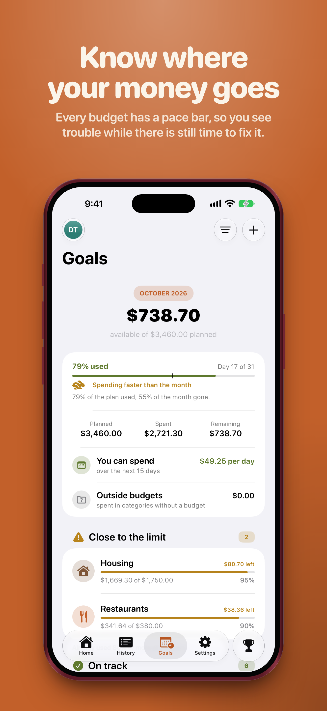
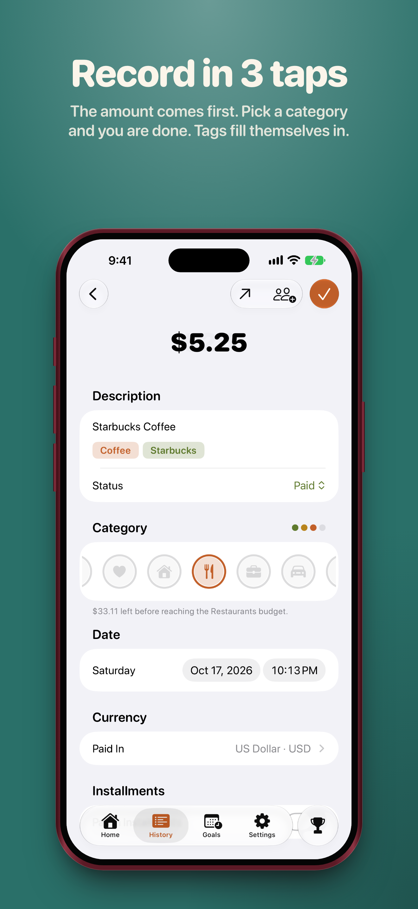
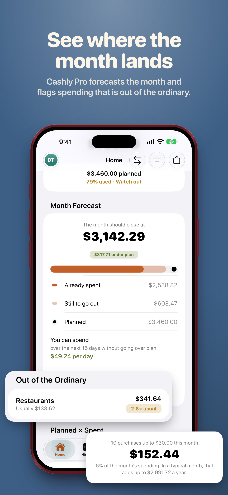
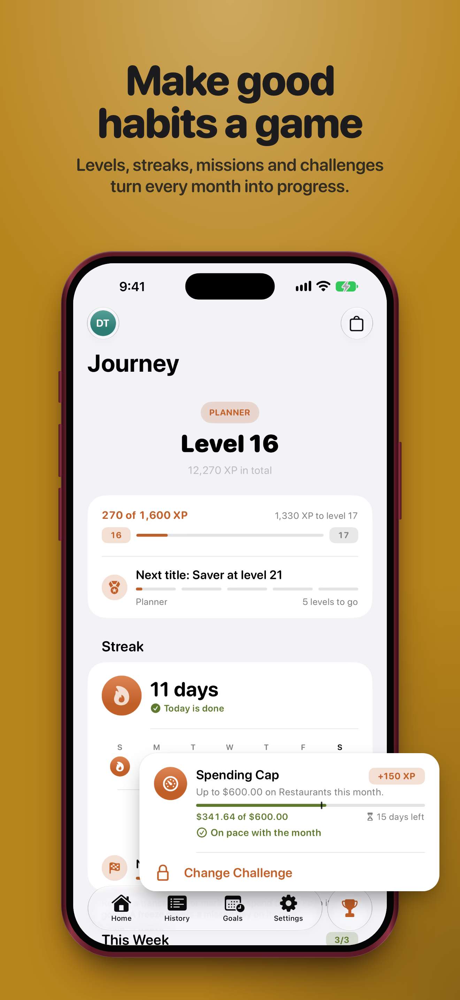
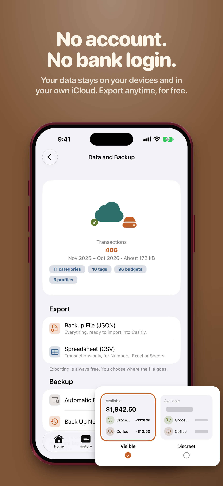

<div align="center">


# Cashly

**Know where your money goes before the month ends.**

A private budget app for iPhone and iPad: budgets with a pace bar, expenses in three taps,<br>
forecasts for the month and a Journey that turns good money habits into a game.

[Website](https://cashly.byescaleira.com) · [App Store](https://apps.apple.com/app/id6821986667) · [Support](https://cashly.byescaleira.com/support) · [Privacy](https://cashly.byescaleira.com/privacy)


</div>

<p align="center">
  
  
  
  
  
</p>

## Why Cashly

Most budget apps want your bank login, an account and your attention. Cashly asks for none of that. Your data lives on your devices and in your own iCloud, the numbers come from deterministic math you can trust, and recording an expense takes seconds from wherever you are.

| | |
| --- | --- |
| **Plan the month** | Budgets by category with a pace bar that marks today, bills and expected income with reminders, goals per month. |
| **Record in seconds** | From the app, widgets, Siri, Shortcuts, Control Center, the Action button or Wallet capture. Split costs equally, by percentage or by amount. |
| **See where it lands** | Month forecast, unusual spending, small purchases that add up, savings and a month score, all computed on device. |
| **Build the habit** | The Journey: levels, streaks, challenges, missions and achievements, with a shop of icons, colors and avatars. |
| **Share what matters** | Shared profiles through iCloud sharing, and Cashly on the Web: scan a QR code and your month opens on any computer, encrypted end to end. |
| **Private by design** | No account, no bank login, no ads, no tracking. The App Store label reads *Data Not Collected*. |

Cashly is free to download. **Cashly Pro** (monthly or yearly, 7-day free trial) adds forecasts and analyses, on-device intelligence, automatic backups, imports, Cashly on the Web and the Claude Code connection. Recording, editing, the Journey and exporting stay free forever.

## Status

| | |
| --- | --- |
| **1.0** | iPhone and iPad, in App Review (October 2026) |
| **1.x** | Mac and Apple Vision Pro with native captures |
| **Languages** | English, Português (Brasil), Español, Deutsch, Français, Italiano, 日本語, 한국어, 简体中文, Русский |

## Architecture

A thin app target on top of **CashlyKit**, a Swift package with one target per feature. Features never import each other: navigation goes through a shared `Route`, and every screen reads its model from the environment.

```
Cashly (app, widgets, App Intents)
└── CashlyKit
    ├── AppShell                 window, navigation, deep links, presenters
    ├── Feature*                 Dashboard · Transactions · Budgets · Categories · Tags · Users
    │                            Journey · Store · Sharing · Settings · Guides · Onboarding · Converter · MCP
    ├── CashlyAnalytics          deterministic analysis engine (+ ML and on-device language model narration)
    ├── CashlyData               SwiftData, CloudKit sync, CKSyncEngine for shared profiles
    ├── CashlyDomain             money, dates, rules, shared types
    ├── CashlyGame               Journey engine
    ├── CashlyWeb                QR pairing and the encrypted month summary
    ├── CashlyMCP                local MCP server for Claude Code
    ├── CashlyExchange           exchange rates
    └── CashlyDesignSystem       tokens, components, Lottie, adaptive layout
```

| Area | Stack |
| --- | --- |
| App | Swift 6, SwiftUI, Observation, SwiftData, CloudKit, StoreKit 2, App Intents, WidgetKit, VisionKit, CryptoKit, Foundation Models, Lottie |
| Web | Static site and web app (vanilla JS, Web Crypto), encrypted relay and admin in Node 22, served by Caddy |
| Quality | Swift Testing, XCUITest, StoreKit testing, SwiftLint, swift-format, zero warnings, Xcode Cloud |

More in [docs/architecture.md](docs/architecture.md).

## Repository

| Path | What lives there |
| --- | --- |
| [`Cashly/`](Cashly) | App and widget targets, catalogs, entitlements, UI tests |
| [`CashlyKit/`](CashlyKit) | The Swift package: every feature, service and test target |
| [`site/`](site) | Landing page in 10 languages, legal pages and the Cashly on the Web dashboard |
| [`bridge/`](bridge) | End-to-end encrypted relay for Cashly on the Web |
| [`admin/`](admin) | Admin for remote flags, minimum versions and the bridge (password + passkey) |
| [`docs/`](docs) | Specs, decisions, design system and App Store media |
| [`scripts/`](scripts) · [`ci_scripts/`](ci_scripts) | Build, test, lint, audit and Xcode Cloud scripts |
| [`plugins/cashly`](plugins/cashly) | Claude Code plugin with import and insights skills |

## Getting started

Open `Cashly.xcworkspace` in Xcode 27 and run the `Production` scheme. The package has no external dependencies besides Lottie.

```sh
scripts/build.sh Debug ios      # build (also macos, visionos)
scripts/test.sh                 # all package tests
scripts/test.sh --affected      # only the targets touched by your changes
scripts/ui-test.sh              # UI tests on large screens
scripts/store-test.sh           # StoreKit purchase tests
scripts/lint.sh                 # SwiftLint
node scripts/site-server.mjs    # site, web app and bridge on localhost:4173
```

The simulator runs with a local store and CloudKit off; signed devices use the `iCloud.cashly` container.

## Claude Code

The app exposes a local MCP server (Settings › Claude Code, Cashly Pro). Every connection and every import is approved inside the app.

```sh
claude plugin marketplace add byescaleira/cashly
claude plugin install cashly@cashly
```

## Documentation

| | |
| --- | --- |
| [Architecture](docs/architecture.md) | Layers, targets, patterns and the feature recipe |
| [Design system](docs/design-system.md) | Tokens, components, motion and adaptive layout |
| [Decisions](docs/decisions.md) | Every product and engineering decision, and why |
| [Analytics engine](docs/analytics.md) | The math behind forecasts, insights and narration |
| [Subscription](docs/subscription.md) | Free and Pro, plans and the paywall |
| [Journey](docs/gamification.md) | Levels, streaks, challenges and the shop |
| [Social](docs/social.md) | Shared profiles and what comes next |
| [Cashly on the Web](docs/web.md) | QR pairing, encryption and the bridge |
| [Admin](docs/admin.md) · [Force update](docs/force-update.md) | Remote flags, minimum versions and operations |
| [Validation](docs/validation.md) | Checks and the manual run before every release |
| [Roadmap](docs/roadmap.md) · [Backlog](docs/backlog.md) | What comes next |

## License

[MIT](LICENSE) © Rafael Escaleira
