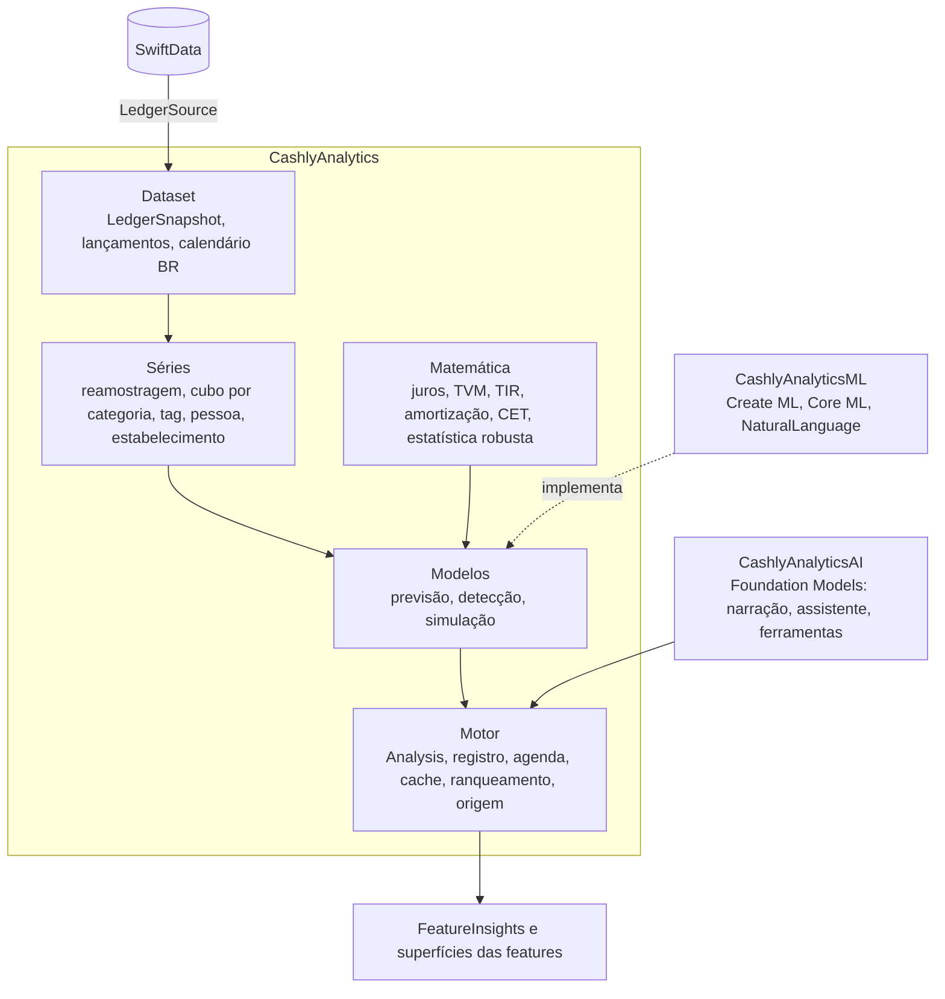

# Motor de análise

A inteligência financeira é o centro do Cashly. Este documento define como ela é construída: isolada da interface, com matemática financeira de verdade, modelos estatísticos e de aprendizado de máquina no aparelho, e modelos de linguagem só para conversar e explicar. Adicionar uma análise nova deve custar um arquivo, os testes dele e uma linha de registro.

## Princípios

1. **Números vêm do cálculo, nunca do modelo de linguagem.** A matemática e a estatística calculam; os modelos de ML estimam com incerteza declarada; o LLM só narra, responde e organiza. Toda resposta do LLM é conferida contra os fatos que ele recebeu.
2. **Isolado em camadas.** O motor não conhece SwiftUI nem SwiftData. Ele recebe um retrato imutável dos dados e devolve resultados tipados. As features só exibem.
3. **Cada análise é um plugin.** Ela declara de que dados precisa, o histórico mínimo, a versão e o tipo do resultado. Um registro descobre, agenda, guarda em cache e ranqueia.
4. **Rastreável.** Todo resultado carrega a origem: método, versão, parâmetros, revisão dos dados, confiança e as transações que servem de evidência. É isso que alimenta o "Como calculamos" na tela.
5. **Medido.** Previsões passam por backtest com métricas padrão. A escolha de modelo é feita por dados, não por opinião.
6. **Privado.** Tudo roda no aparelho por padrão. O Private Cloud Compute da Apple é opcional para raciocínio mais pesado. Nada vai para terceiros sem escolha explícita da pessoa.

## Camadas



### L0 Dataset

- **`LedgerSource`:** protocolo definido no motor e implementado pelo `CashlyData`, que entrega um `LedgerSnapshot` por revisão.
- **`LedgerSnapshot`:** fatos normalizados e imutáveis.
  - **Lançamentos:** um por parcela e por mês de competência, em centavos com sinal, com categoria, tags, status, parte de cada participante, índice da parcela e a transação de origem.
  - **Orçamentos** e **calendário**: dias úteis, feriados nacionais e datas de pagamento típicas.
- **Atualização incremental:** o retrato é refeito só quando o `datasetRevision` muda, e as séries são atualizadas por diferença. Isso substitui a releitura completa do mês que o backlog aponta como gargalo.

### L1 Séries

- **`TimeSeries`:** diária, semanal ou mensal, com reamostragem e calendário.
- **Cubo de agregação:** pessoa × categoria × tag × estabelecimento × mês.
- **Atributos para modelos:**
  - defasagens e médias móveis;
  - dia do mês e dia útil;
  - semana do pagamento;
  - mês com 13º salário, IPVA, IPTU e material escolar (sazonalidade brasileira de janeiro a março e de novembro a dezembro).

### L2 Matemática (`FinancialMath`, `Statistics`)

- **Valor do dinheiro no tempo:** VP, VF, PMT, VPL e TIR (Newton com bissecção de segurança). Conversão de taxas (a.m. ↔ a.a., nominal ↔ efetiva).
- **Parcelamentos:**
  - tabelas Price e SAC;
  - **CET** de uma compra parcelada;
  - **custo implícito do "parcelado sem juros"** quando há desconto à vista;
  - comparação com o rendimento do dinheiro parado (CDI informado).
- **Inflação:** valores reais × nominais pelo IPCA, para comparar anos diferentes de forma justa.
- **Estatística robusta:**
  - mediana, MAD e quantis;
  - média móvel exponencial;
  - algoritmo de Welford para atualização incremental;
  - bootstrap para intervalos.
- **Desempenho:** vetores com Accelerate (`vDSP`), para rodar anos de histórico em milissegundos.

### L3 Modelos

**Previsão (`Forecaster`):**
- Modelos: ingênuo, ingênuo sazonal, média robusta, ETS/Holt-Winters amortecido e **Croston**, este para categorias de gasto esporádico (médico, manutenção) em que a média engana.
- **Seleção automática:** cada série escolhe o modelo pelo backtest. O ensemble pondera pelo erro.
- **Saída:** valor central e intervalo (p10–p90). A cobertura do intervalo é medida.

**Detecção:**
- **Valores atípicos:** z-score robusto pela mediana e MAD.
- **Mudança de patamar:** CUSUM. Exemplo: "desde julho seus gastos com transporte subiram de patamar".
- **Recorrências e assinaturas:** periodicidade mais similaridade de descrição.
- **Deriva por categoria.**

**Simulação:**
- **Monte Carlo do fluxo de caixa:** chance de fechar o mês no vermelho e data provável de atingir uma meta.
- **Plano de dívidas** (avalanche × bola de neve).
- **Cenários "e se".**

**Prescrição:**
- orçamento sugerido por quantil do histórico;
- cortes com maior efeito e menor esforço;
- realocação entre categorias.

**ML no aparelho (`CashlyAnalyticsML`, implementando protocolos do L3):**
- **Modelo global de previsão:** `MLBoostedTreeRegressor` (Create ML, roda no iPhone) treinado com os atributos do L1 de todas as categorias da pessoa. Entra no ensemble só quando vence o backtest.
- **Texto e estabelecimentos:** `NLContextualEmbedding` para agrupar descrições parecidas ("NETFLIX.COM", "Netflix *123") e sugerir categoria por vizinhos próximos. Substitui o Naive Bayes atual quando medir melhor.
- **Modelos pré-treinados (Core ML):** um classificador de descrição → categoria treinado fora do aparelho com dados sintéticos e públicos brasileiros, personalizado no aparelho pelos vizinhos da própria pessoa.

### L4 Motor

```swift
protocol Analysis: Sendable {
    associatedtype Output: AnalysisOutput
    static var id: AnalysisID { get }
    static var version: Int { get }
    static var requirements: DataRequirements { get }
    func run(_ context: AnalysisContext) async throws -> Output
}
```

- **`AnalysisContext`:** dá acesso ao retrato, às séries, aos modelos e aos resultados de outras análises declaradas como dependência. O motor monta um grafo e roda na ordem.
- **Tipos de saída:**
  - `Metric`: número com unidade e comparação;
  - `Forecast`: série com intervalo;
  - `Finding`: um fato relevante;
  - `Recommendation`: uma ação com impacto estimado;
  - `Series`: para gráficos.
  - Todos carregam `Provenance` (método, versão, parâmetros, revisão, confiança, evidências).
- **Agenda:** roda quando os dados mudam (com espera curta) e com prioridade por superfície visível. O pesado (re-treino, backtest) vai para `BGProcessingTask`. Tudo é cancelável e guardado em cache por revisão.
- **Ranqueamento:** impacto em reais × urgência × confiança × novidade × retorno da pessoa (dispensou, achou útil).
- **Classes de análise:** descritiva (o que aconteceu), diagnóstica (por quê, como a decomposição da variação em preço × quantidade e contribuição por categoria), preditiva (o que vem) e prescritiva (o que fazer).

### L5 Modelos de linguagem (`CashlyAnalyticsAI`)

Usa o Foundation Models do iOS 27 pelo protocolo `LanguageModel`, o que permite trocar o provedor sem mudar o resto:

| Provedor | Quando | Plano |
| --- | --- | --- |
| `SystemLanguageModel` (no aparelho) | Narração de insights, texto livre → transação, respostas curtas | Pro |
| `PrivateCloudComputeLanguageModel` | Perguntas que pedem mais raciocínio ou contexto, como o relatório mensal | Pro |
| Modelo em servidor (ex.: Claude) | Só se a pessoa ligar, com aviso de que os dados saem do aparelho; exige backend | Decisão pendente |

- **Narrador:** recebe `Finding`s e `Metric`s e devolve texto por geração guiada (`@Generable`). Cada número citado é validado contra a entrada; se não bater, o texto é descartado e entra um modelo de frase pronto.
- **Assistente "Pergunte ao Cashly":**
  - ferramentas (`Tool`) que chamam o motor: totais, séries, previsões, transações por filtro e simulações;
  - modo de chamada de ferramentas controlado (`ToolCallingMode`);
  - as respostas citam as evidências.
- **Entrada e documentos:** texto livre → transação estruturada; comprovante por imagem com `OCRTool`.
- **Avaliação:**
  - conjunto de perguntas com respostas esperadas, rodando no `CashlyAudit`;
  - repetir a cada versão do iOS, porque o modelo do sistema muda com as atualizações;
  - medição de tokens e latência com o instrumento do Xcode.

## Estrutura de código

```
CashlyAnalytics/          sem UI, sem SwiftData, sem frameworks de ML
  Dataset/                LedgerSource, LedgerSnapshot, Posting, BrazilianCalendar
  Math/                   TimeValue, Amortization, EffectiveCost, Inflation, Statistics
  Series/                 TimeSeries, Resample, Cube, Features
  Forecast/               Forecaster, Naive, SeasonalNaive, ETS, Croston, Ensemble, Backtest
  Detect/                 Outliers, Changepoint, Recurrence, Drift
  Simulate/               MonteCarlo, DebtPayoff, Goals, Scenario
  Engine/                 Analysis, Registry, Scheduler, Cache, Ranking, Provenance
  Analyses/               um arquivo por análise
CashlyAnalyticsML/        Create ML, Core ML, NaturalLanguage
CashlyAnalyticsAI/        Foundation Models: Narrator, Assistant, Tools, Evaluation
FeatureInsights/          destaques, detalhe com "Como calculamos", assistente
```

- **Dependências:** `Domain` ← `Analytics` ← (`AnalyticsML`, `AnalyticsAI`) ← `FeatureInsights`. O `CashlyData` implementa o `LedgerSource`.
- **Componentes compartilhados:** um `InsightsModel` no `FeatureCore` serve os componentes que outras features usam (aviso no editor, cartão no Início), sem uma feature importar outra.

## Qualidade

- **Personas sintéticas no `CashlyMock`:** assalariado, autônomo com renda irregular, família com parcelamentos, estudante, aposentado. São 3 a 5 anos de dados com sazonalidade brasileira, usados em testes e no backtest.
- **Testes de propriedade na matemática.** Exemplos: VPL na TIR é zero; soma das parcelas SAC igual ao principal mais juros; a reamostragem preserva totais.
- **Backtest no `CashlyAudit`:** `analytics backtest` reporta MAE, MASE e cobertura dos intervalos por persona e por modelo. O CI falha se uma mudança piorar as métricas além de uma margem.
- **Orçamento de desempenho:** rodar o conjunto padrão de análises em 5 anos de dados abaixo de um limite medido no `benchmark`.
- **Partida a frio:**
  - com pouco histórico, usar regras e informações certas (parcelas, recorrências marcadas);
  - mostrar "ainda aprendendo" em vez de inventar;
  - a confiança cresce com os dados.

## Dados que valem a pena guardar

1. **Vencimento e data de pagamento** separados da data da compra (competência, no backlog). Permitem fluxo de caixa e atrasos reais.
2. **Recorrência marcada pela pessoa**, para completar a detecção automática.
3. **Estabelecimento normalizado**, separado da descrição livre. Vem do Wallet, do comprovante e do assistente.
4. **Data de criação do registro**, para medir hábito sem depender da data da compra.
5. **Retorno sobre insights** (dispensado, útil), guardado localmente para o ranqueamento.

## Primeiras análises

| Análise | Classe | Base |
| --- | --- | --- |
| Compromissos de parcelas nos próximos meses | Preditiva (certa) | Lançamentos |
| Ritmo do mês e fechamento projetado | Preditiva | Série diária + curva típica do mês |
| Quanto posso gastar por dia | Prescritiva | Orçamento restante ÷ dias, menos recorrências por vir |
| Categoria fora do padrão | Diagnóstica | Média robusta + z-score |
| Comparação no mesmo ponto do mês | Descritiva | Série diária |
| Assinaturas e recorrências | Descritiva | Recorrência + embeddings |
| Previsão por categoria com faixa | Preditiva | Ensemble + backtest |
| Orçamento sugerido | Prescritiva | Quantis da previsão |
| Custo real do parcelamento (CET) | Diagnóstica | TVM + CDI |
| Risco de fechar no vermelho | Preditiva | Monte Carlo |
| Decomposição da variação do mês | Diagnóstica | Contribuição por categoria |

## Fases

| Fase | Entrega |
| --- | --- |
| A. Fundação | `CashlyAnalytics` com dataset, séries, matemática, motor e origem; `LedgerSource` no `CashlyData`; personas sintéticas; `CashlyAudit analytics`; três análises certas (parcelas, ritmo, quanto posso gastar) |
| B. Previsão | Forecasters, backtest, seleção automática e intervalos; substitui a previsão atual e o botão "Treinar" |
| A+. Início (feito) | Comparação no mesmo ponto do mês e categorias fora do padrão; seções Este mês, Comparado aos outros meses, Fora do padrão e Próximos meses no Início |
| C. Detecção | Atípicos, mudança de patamar, recorrências e assinaturas, embeddings de descrição |
| D. Matemática aplicada | CET, plano de dívidas, Monte Carlo, metas, orçamento sugerido |
| E. ML | Modelo global com boosted trees, classificador pré-treinado, personalização |
| F. Linguagem | Narrador, assistente com ferramentas, PCC, avaliação contínua |
| G. Interface | `FeatureInsights`, "Como calculamos", gráficos com faixa, superfícies nas features |
