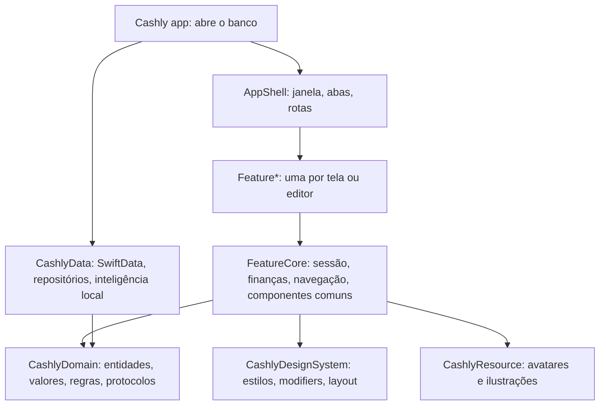

# Arquitetura

O Cashly é um app de finanças pessoais para iOS, macOS e visionOS 27, em Swift 6.2, SwiftUI, SwiftData e Observation. O app (`Cashly/Cashly`) só abre o banco e entrega a janela ao pacote `CashlyKit`, onde está todo o código.

As decisões que levaram a esta forma estão em [decisions.md](decisions.md); o que falta fazer está em [backlog.md](backlog.md).

## Camadas

| Target | Responsabilidade | Depende de |
| --- | --- | --- |
| `CashlyDomain` | Entidades (`Transaction`, `Budget`, `Category`…), valores (`Money` em centavos, `YearMonth`), regras puras (`BudgetUsage`, `BudgetHealth`, `TransactionAllocation`…), formato de backup (`CashlyBackup`), protocolos de repositório | nada |
| `CashlyData` | `CashlyDatabase`, `CashlyStore` (`@ModelActor`), schemas V1 a V4 congelados e V5 atual (capturas e memória de estabelecimentos), repositórios por agregado, backup (`CashlyDatabase.backup`), `CashlyChangeHub`, `LocalIntelligenceService` | Domain |
| `CashlyDesignSystem` | `Styles/` (extensions de `ShapeStyle`, paleta retrô em `Color+Retro`, `Color(hex:)`, `\.appTint`), `Modifiers/` (extensions de `View`, como `.amountLine()`), `Layout/` (`AdaptiveList`, `AdaptiveStack`, `AdaptiveRow`, `SurfaceContainer`) | nada |
| `CashlyResource` | Avatares e ilustrações | nada |
| `FeatureCore` | Estado compartilhado (`SessionModel`, `FinanceModel`, `IntelligenceModel`, `EditorStatus`, `TransactionFilter`), navegação (`Route`, `AppSection`, `CashlyNavigation`, `\.open`, `\.close`), componentes usados por mais de uma feature (como `RetroColorPicker` e `ColorSection`, com as 26 cores nomeadas de `RetroColor`, e `AppIcon`/`AppIconImage`, usados pelos Ajustes e pela loja), textos de exibição, `ProAccess` e `ShopAccess` (ambiente), `CashlyTips` (configuração do TipKit e eventos compartilhados; cada feature declara as suas `Tip`s), `IntentActions` e `CaptureActions` (lógica dos App Intents e da caixa de entrada de capturas), `CaptureNotifier` (notificação por captura, ações e contador do ícone) | Domain, DesignSystem, Resource |
| `Feature*` | Uma área do app: model, telas e seções | Domain, DesignSystem, FeatureCore |
| `FeatureSettings` | Ajustes do app (`SettingsModel`, `DataModel`, `AppInfo`), um por processo e não por janela | Domain, FeatureCore |
| `AppShell` | `CashlyWindow`, `MainScreen`, `SectionStack`, `RouteScreen`, folha lateral (`routeInspector`), `CashlyServices` (banco e perfil sem janela), App Intents e entidades (`Intents/`, incluindo `CaptureTransactionIntent` para a automação do Wallet), indexação no Spotlight, `NotificationResponder` (ações das notificações, inclusive as de captura) e `DeepLinks` (`cashly://`, com `captures/<id>`) | todas as features |
| `CashlyMock` | `SampleData` e `SampleDatabase` em memória | Domain, Data |
| `CashlyPreview` | Previews por feature sobre o `SampleDatabase` | AppShell, features, Mock |
| `CashlyAudit` | Diagnóstico e validação automatizada (migração, integridade, volume) | Domain, Data, Mock |
| `CashlyWidgets` (app) | Extensão WidgetKit: lê o `WidgetSnapshot` da pasta `cashly/` no App Group `group.com.byescaleira` (`AppGroup` e `manifest.json` no domínio); produto `CashlyWidgetKit` | Domain, DesignSystem |

Regras de dependência:

- Uma feature nunca importa outra. Quando duas precisam da mesma peça, ela vai para `FeatureCore`. A única exceção é `FeatureStore`, que é um serviço (StoreKit) importado por `FeatureJourney` (loja) e `FeatureSettings` (Cashly Pro).
- Features não conhecem `CashlyData`: falam com repositórios do domínio por `Repositories`.
- Só o `AppShell` conhece todas as features e monta as telas.

## Features

| Target | Conteúdo |
| --- | --- |
| `FeatureDashboard` | `HomeScreen` com `DashboardModel` (resumo do período, pontuação, disponível, maiores gastos) e `ReportsModel` (planejado × gasto, gastos por tag, previsão e gráficos) |
| `FeatureMCP` | `MCPModel` (servidor MCP local no Mac, token, conferência pendente) e `MCPSettingsSection` |
| `FeatureGuides` | `GuideScreen`: tutoriais (`Guide`) e importação de planilha (`SpreadsheetImportModel`) |
| `FeatureOnboarding` | `OnboardingModel` e `OnboardingScreen`: primeira abertura, perfil e categorias sugeridas |
| `FeatureJourney` | `JourneyModel` e `JourneyScreen`: nível, sequência, missões, desafio, conquistas e a loja (`ShopScreen`, `ShopItemScreen`), sobre o motor `CashlyGame` e o `StoreModel` |
| `FeatureStore` | `StoreModel` (StoreKit 2): produtos do catálogo `ShopItem`, compra, restauração, itens possuídos, `Entitlement` do Cashly Pro e crédito único de consumíveis como `GameEvent`; `PaywallScreen` com `SubscriptionStoreView` |
| `FeatureTransactions` | Lista paginada com seleção (`TransactionListModel`) e editor (`TransactionEditorModel`) |
| `FeatureCategories` | Lista, detalhe e editor de categoria |
| `FeatureBudgets` | Editor de orçamento e resolução de conflito |
| `FeatureTags` | Editor de tag |
| `FeatureUsers` | Editor de usuário |
| `FeatureSettings` | Aparência e ícone, moeda, notificações, inteligência (estado e treino dos modelos), iCloud (estado e última sincronização), dados (backup, planilha CSV, backup automático, importar, apagar tudo), ajuda, sobre e novidades |

## Estado e fluxo de dados

- **App.** `CashlyApp` cria um `SettingsModel` para o processo inteiro e o injeta com `.cashlySettings(_:)`, que também aplica o tema em todas as janelas. A preferência de iCloud é lida antes de abrir o banco e só vale na abertura seguinte. Quando o banco abre, o app entrega ao `SettingsModel` um `DataModel` com o `BackupRepository`, que não é preso a usuário: backup e "apagar tudo" valem para o banco inteiro.
- **Janela.** `CashlyWindow` cria, por janela, `SessionModel` (usuário selecionado, filtro, repositórios do usuário), `FinanceModel` (resumo do período), `TransactionListModel`, `IntelligenceModel` e `CashlyNavigation`, e os injeta no ambiente. Duas janelas podem ter usuários diferentes.
- **Escopo.** `SessionModel.repositories` entrega repositórios presos ao usuário da janela; o store recusa leitura e escrita de outro dono.
- **Lembretes.** `NotificationsModel` (em `FeatureCore`, porque o `AppShell` agenda e os Ajustes mostram) fala com o sistema por `NotificationScheduling`. O `MainScreen` reagenda os vencimentos do usuário da janela sempre que a sessão recarrega; `PaymentSchedule` (domínio) escolhe as 50 parcelas pendentes mais próximas, às 9h do dia. A cada revisão dos dados o `MainScreen` também chama `reviewCaptures`, que registra de novo as categorias de notificação de captura com as categorias do perfil e atualiza o contador do ícone com as capturas pendentes.
- **Mudanças.** O `CashlyChangeHub` avisa a sessão quando o banco muda (inclusive por CloudKit), e a sessão recarrega o que estiver na tela.
- **Editores.** Cada rota de edição recebe um model novo por `ModelHost`, com `EditorStatus` para carregar, salvar e excluir com proteção contra respostas atrasadas. `.editorLifecycle` cuida de carregar, fechar ao salvar e mostrar erros.
- **Dinheiro.** Valores são `Money` em centavos inteiros; `Double` só existe na borda da interface. A moeda exibida e gravada nos registros novos vem de `CurrencySetting.shared`, observável e segura entre threads; a formatação (`.appCurrency`, `Money.formatted`) lê dela, então as telas se atualizam quando ela muda.

## Navegação

- `TabView` em `sidebarAdaptable` com uma `NavigationStack` por aba (`SectionStack`): Início, Transações, Planejamento, Ajustes e Jornada (papel proeminente, em bolha separada no fim da barra; some quando a pessoa esconde a Jornada nos Ajustes ou a flag `journey` está desligada). O app abre no Início.
- Telas pedem navegação por `@Environment(\.open)` com uma `Route`; o `AppShell` decide como apresentar: em largura regular, numa folha de vidro com alturas recolhida, média e grande e o fundo usável, presa à lateral direita quando a janela está na horizontal (`presentationPlacement(.trailing)`) e centralizada na vertical; no Mac, no `.inspector`; no visionOS, em sheet; em largura compacta, por push.
- `@Environment(\.close)` fecha a rota no contexto certo (inspector, pilha do inspector ou pilha da aba).
- Ajustes são uma aba em todas as plataformas; no Mac também abrem na janela de Ajustes do sistema (cena `Settings`, ⌘,). O menu do avatar só troca, edita e adiciona usuários.
- Ícones alternativos são pastas `.icon` em `Cashly/Cashly` (`CashlyIcon` + nome do `case` com inicial maiúscula, como `CashlyIconCandyCane`), incluídas por `ASSETCATALOG_COMPILER_INCLUDE_ALL_APPICON_ASSETS`. São 10 coleções com exatamente 4 ícones cada (Cores, Moda, Países, Esportes, Anos 80, Verão, Carnaval, Festa Junina, Halloween, Natal), regra coberta pelo `AppIconTests`. Para um novo, crie a pasta, acrescente o `case` em `AppIcon` (`FeatureCore/Icons`) e rode `scripts/icons.sh` para exportar a prévia.
- Os links de ajuda e sobre vêm das chaves `CashlyAppStoreID`, `CashlySupportEmail`, `CashlyHelpURL`, `CashlyPrivacyURL` e `CashlyTermsURL` do `Info.plist`; a linha some enquanto a chave estiver vazia.

## Views

- Todo model chega por `@Environment(Tipo.self)`. Para editar, `@Bindable var model = model` dentro do `body`. Views não recebem model por `init` nem guardam model em `@State`.
- Dados, contas e ações ficam no model. A view só lê estado e chama métodos.
- A tela só monta seções; cada seção é uma `struct` própria no mesmo target.
- Visual nativo: `List`/`Form` do sistema, Liquid Glass só em controles, `Color.primary`/`Color.secondary` para texto (em cabeçalho de lista, `.primary` hierárquico fica cinza).
- **Texto grande.** Toda tela precisa funcionar do tamanho padrão aos tamanhos de acessibilidade:
  - pares curtos lado a lado (valor e porcentagem, título e seletor) usam `AdaptiveStack`, um `ViewThatFits` que empilha quando a linha não cabe;
  - linhas de lista com texto livre (transação, categoria, participante) usam `AdaptiveRow`, que empilha nos tamanhos de acessibilidade;
  - valores monetários usam `.amountLine()`: uma linha, reduzindo a fonte em vez de quebrar o número;
  - seletores usam `Picker` nativo, que já se ajusta; gráficos têm altura em `@ScaledMetric`.
- Telas de painel, o Histórico e a Busca usam `AdaptiveList`: com largura para uma coluna é a `List` nativa (com seleção opcional); com mais, as mesmas `Section` se distribuem em colunas de no mínimo 320 pt. Formulários usam `readableWidth()`, uma coluna central de até 560 pt. Nenhuma tela estica.
- **Idiomas:** inglês é o idioma de desenvolvimento. Há traduções para português (Brasil), espanhol, alemão, francês, italiano, japonês, coreano, chinês simplificado e russo, num catálogo único (`Cashly/Cashly/Localizable.xcstrings`, mais `InfoPlist.xcstrings`). As features não têm catálogo próprio.
  - **Telas:** usam chaves em inglês (`Text("Save")`), resolvidas pelo `\.locale` do ambiente.
  - **Modelos e domínio:** usam `String(appLocalized:)`, que lê o idioma escolhido no `LanguageSetting`.
  - **Formatação:** valores formatados como `String` usam `.locale(.app)`.
  - **Contagens:** usam uma chave só com variações de plural no catálogo, nunca `count == 1 ? … : …`.
  - **Troca de idioma:** Ajustes › Idioma muda na hora (o `MainScreen` recria as abas pelo `locale`) e grava `AppleLanguages` para os textos do sistema na próxima abertura.
  - **Sincronização:** `scripts/strings.sh` sincroniza o catálogo com as strings extraídas de todos os módulos.

## Receita: adicionar uma feature

Exemplo: "Metas".

1. **Domain:** `Entities/Goal.swift`, `Repositories/GoalRepository.swift` e, se houver cálculo, `Rules/GoalProgress.swift` com teste.
2. **Data:** `@Model GoalEntity` num novo schema versionado, mapeamento no `CashlyStore`, `SwiftDataGoalRepository` e o repositório em `Repositories`.
3. **Feature:** target `FeatureGoals` com `GoalDraft`, `GoalEditorModel` (`EditorStatus`, `canSave`, `canRemove`, `load`, `save`, `remove`), `GoalEditorScreen` curta (seções, `EditorActions`, `.editorLifecycle`); os textos novos, em inglês, entram no catálogo único com as traduções.
4. **Rotas:** `case` em `Route` e o mapeamento em `AppShell/RouteScreen` com `ModelHost`; se for aba, um `case` em `AppSection`.
5. **Testes:** regra no `CashlyDomainTests`, repositório no `CashlyDataTests` e model no target `FeatureGoalsTests`, sobre `CashlyDatabase.open(inMemory: true)`. Acrescentar o target ao scheme `CashlyKitTests`.
6. **Preview:** um arquivo em `CashlyPreview`.

## Regras de código

- Sem comentários em Swift, inclusive cabeçalhos; a única exceção é `// swift-tools-version`. O lint bloqueia.
- O mais simples que resolva: sem abstração antecipada nem protocolo para tipo com uma única implementação fora de fronteira de módulo.
- Um tipo principal por arquivo, com o nome do arquivo; arquivos até 400 linhas, corpos de tipo até 250, funções até 7 parâmetros.
- Sem extensions públicas em tipos da biblioteca padrão.

## Ferramentas

| Script | O que faz |
| --- | --- |
| `scripts/format.sh` | Formata com o `swift-format` do Xcode (`--check` só verifica) |
| `scripts/lint.sh` | Verifica formatação e roda o SwiftLint 0.65.1 em modo estrito, instalado em `.tools` com checksum |
| `scripts/build.sh Debug\|Release` | Compila o app para iOS, macOS e visionOS |
| `scripts/test.sh` | Roda o scheme compartilhado `CashlyKitTests` no simulador do iPhone 17 com iOS 27 |
| `scripts/audit.sh` | Compila o `CashlyAudit` e roda `check`: migração de um banco V1, seed de preview e benchmark de 1.000 registros com 27 verificações |
| `scripts/strings.sh` | Sincroniza o catálogo único com as strings extraídas pelo compilador em todos os módulos |

Os testes rodam só no simulador: o `FeatureCore` usa APIs do SwiftUI 27 que o macOS do host pode não ter. O `CashlyAudit` não depende de SwiftUI e roda no Mac.

O SwiftLint usa só regras de segurança, tamanho e a regra própria `no_comments`; a formatação fica com o `swift-format`. Para atualizar o SwiftLint, troque versão e checksum juntos em `scripts/install-swiftlint.sh`.

## Integração contínua

O CI é o Xcode Cloud. Os workflows (gatilhos, ações e destinos) ficam no App Store Connect; o repositório guarda apenas:

- `ci_scripts/ci_pre_xcodebuild.sh`: na etapa `build-for-testing` de uma ação de teste, roda `scripts/lint.sh` e `scripts/audit.sh` antes da compilação.
- `Cashly.xcworkspace/xcshareddata/xcschemes/CashlyKitTests.xcscheme`: o scheme que a ação de teste usa.

Workflow recomendado: ação **Test** com o scheme `CashlyKitTests` no iPhone 17 (iOS 27) e ação **Build** do scheme `Production` para iOS, macOS e visionOS, disparadas em pull requests e na branch principal.
