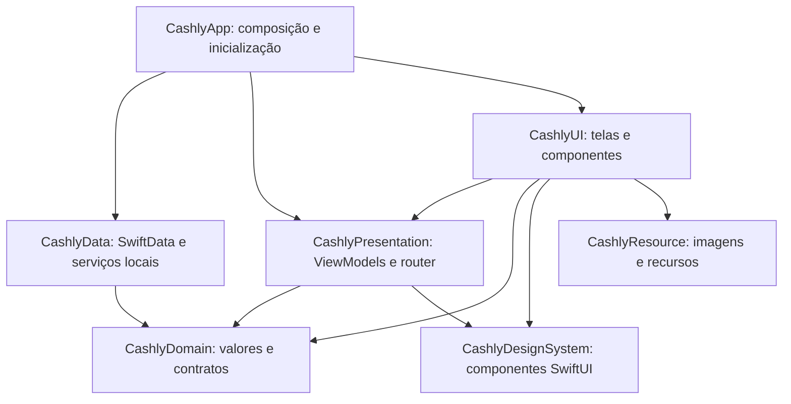

# Arquitetura do Cashly

## Responsabilidades e direção das dependências

`CashlyDomain` importa Foundation, sem SwiftUI, SwiftData ou Ryze. Contém DTOs `Sendable`, regras de transações, calendário financeiro e contratos específicos de leitura e escrita. As entidades `@Model` ficam em `CashlyData/Persistence/Entities`.

`CashlyData` implementa os contratos. Um `CashlyRepository` com `@ModelActor` é compartilhado pelos contratos da factory. As operações estão separadas em extensões por entidade, mas permanecem no mesmo actor e ModelContext. Isso permite salvar uma transação e seus participantes juntos e desfazer alterações quando a operação falha. A serialização protege as operações locais; a resolução de conflitos entre dispositivos é uma responsabilidade adicional.

`CashlyPresentation` mantém estado e coordena intenções do usuário. Há ViewModels próprios para usuário, categoria, orçamento, transação, tag, painel e inteligência. Todos ficam no `@MainActor`, com `@Observable`. Os campos editáveis estão em drafts; os estados de carregamento e conclusão têm escrita restrita. A política de integridade referencial fica no repositório, evitando verificações independentes nas telas antes de excluir registros.

`CashlyUI` apresenta esse estado. As telas não conhecem ModelContext nem modelos SwiftData. `CashlyDesignSystem` fornece tokens, layouts e componentes nativos que substituem os componentes do Ryze. Recursos e previews têm módulos próprios.

Materiais possuem duas responsabilidades no DesignSystem: `cashlySurface` para controles de vidro nativo e `cashlyContentSurface` para indicadores coloridos dentro do conteúdo. O primeiro usa Glass.regular em iOS/macOS e glassBackgroundEffect em visionOS, consultando a habilitação do controle para interatividade. `CashlySurfaceContainer` agrupa controles de vidro quando necessário e expõe a distância óptica de composição. Detalhes da revisão estão em [Liquid Glass e materiais](liquid-glass-review.md).

## Observation e ciclo de vida

O app cria as dependências na raiz. `CashlySession` agrupa o MainViewModel, router, inteligência e factory de apresentação de uma janela. O armazenamento e o serviço de inteligência podem ser compartilhados; cada janela recebe sua própria navegação e estado de tela.

- `@State` mantém a identidade do ViewModel pertencente a um formulário. Abrir outro formulário cria outra instância, sem reaproveitar o rascunho do anterior.
- `@Environment(Tipo.self)` fornece os objetos compartilhados à árvore de views.
- `@Bindable` cria bindings somente nos pontos que editam propriedades observadas.
- `@ObservationIgnored` exclui dependências e controle interno de requisições da observação.

O MainViewModel mantém um contador de revisão para descartar respostas antigas de carregamento. Filtros viram IDs e critérios de consultas do usuário/período; a interface mantém somente a página carregada. As sugestões de inteligência usam tasks vinculadas à identidade da entrada, com debounce e verificação de cancelamento antes de aplicar o resultado. A troca de usuário limpa a navegação anterior e impede aplicar previsões de outro usuário.

Os catálogos dos editores de orçamento e transação usam `.task(id:)`, com cancelamento e revisão do carregamento inicial. Reentradas atualizam apenas as opções, preservando o draft. A seleção de participantes deriva diretamente de `draft.participants` por Binding; não há um segundo Set de usuários para sincronizar. ViewModels de formulário permanecem em `@State` e não são injetados no ambiente quando nenhum descendente os consome.

`SpendingForecastSection` mantém o valor previsto em estado local. A identidade da tarefa inclui usuário, competência, filtro de data, categorias de planejamento e versão dos modelos. `IntelligenceViewModel` coordena as consultas; a tela não mantém esse resultado no estado compartilhado do painel. A previsão consulta cada categoria apenas uma vez.

## Navegação inspirada no bread-such

A referência foi `BreadSuchNavigation`, `BreadSuchDestination`, `BreadSuchRoute` e `EnvironmentValues+Extension` do projeto bread-such.

`CashlyNavigation` observa a seção selecionada, as pilhas independentes por seção, o destino modal e sua pilha interna. `MainRoute` contém os destinos concretos, IDs e seeds pequenos. `MainScreen` mantém as pilhas e o ciclo de vida compartilhado. `CashlyRouteScreen` transforma rotas em telas e delimita as factories por usuário; `CashlySheetScreen` contém a navegação modal e fecha a apresentação pelo dismiss do SwiftUI.

As views usam a ação `open(route, in: section)` do ambiente. Em largura compacta, a ação adiciona o destino à pilha da seção. Em largura regular, apresenta uma sheet. Se já existe uma sheet, o próximo destino entra na pilha dessa apresentação. Salvar usa o dismiss do SwiftUI e atualiza os dados compartilhados; não exige reconstruir a pilha inteira.

As rotas de edição carregam o ID; o destino cria um draft próprio. O formulário busca o registro atual quando abre. O detalhe de categoria também resolve a categoria pelo ID no estado atual, para acompanhar alterações de nome, cor e ícone.

## Patterns escolhidos por responsabilidade

| Necessidade | Solução aplicada | Motivo e limite |
| --- | --- | --- |
| Organizar tela e estado | MVVM + drafts por formulário | Torna explícito quem edita, valida, salva e exibe cada estado. |
| Atualizar a interface | Observation, função de Observer | Usa o mecanismo do SwiftUI, sem manter uma infraestrutura paralela de listeners. |
| Isolar o armazenamento | Repository + contratos pequenos | ViewModels dependem de operações relevantes; o repositório controla a consistência do aggregate transação/participantes. |
| Separar modelos persistidos e de domínio | Mapeamento como Adapter | A conversão está na fronteira de dados. Entidades SwiftData não atravessam os contratos. |
| Construir dependências | Factories simples + raiz de composição | Compartilha o repositório e cria ViewModels por destino. Não exige herança de factories. |
| Coordenar navegação | Router/Coordinator, função de Mediator | Centraliza push, sheet e seção; telas não precisam conhecer outras telas ou pilhas. |
| Substituir inteligência | Contrato `IntelligenceUseCase` | Permite introduzir outra implementação quando houver necessidade real; hoje há uma implementação local. |
| Aplicar comportamentos de UI | ViewModifiers, composição semelhante a Decorator | Reutiliza alerta, sugestões e conclusão sem criar hierarquias de telas. |

O catálogo de [patterns do Refactoring.Guru](https://refactoring.guru/pt-br/design-patterns) é uma referência de soluções. As escolhas acima correspondem às responsabilidades do Cashly. MVVM, Repository e Coordinator também são conceitos arquiteturais além dos patterns clássicos do catálogo.

Builder, Visitor, uma hierarquia de State, Command para cada botão e cadeias de middleware acrescentariam estruturas sem resolver uma variação atual do produto. Uma nova abstração deve representar uma regra compartilhada ou uma implementação que realmente precise variar. Os protocolos de domínio existem pela fronteira entre módulos; os componentes locais e ViewModels concretos não precisam de um protocolo próprio por classe.

## Persistência, dinheiro e contexto

`CashlySchemaV1` e `CashlySchemaV2` congelam os layouts históricos. V3 acrescenta classificação independente e tipo de entrada/saída sem remover os campos legados. `CashlyMigrationPlan` usa etapas leves V1 → V2 → V3; `prepare` converte valores, deriva proprietário e intervalo de meses e materializa tags legadas por ID. Referências indisponíveis permanecem intactas para uma importação posterior. Falha na abertura gera erro e opção de tentar novamente; não recria o banco.

`Money` usa centavos Int64 e BRL explícito. Entradas de controles são convertidas e arredondadas uma vez na fronteira. Somas e subtrações verificam overflow. Divisão igual atribui o restante ao responsável e depois aos IDs dos participantes em ordem estável. Percentuais usam maiores restos, com desempate estável; parcelas atribuem os centavos restantes aos primeiros meses. Cada participação é parcelada de forma que sua soma reconcilie o valor integral. Double aparece em controles, coordenadas de gráficos, razões e estimativas; os totais financeiros são calculados em Money.

Cada factory delimitada recebe um userID imutável e compartilha o mesmo repositório. O actor não possui usuário atual. A seleção de uma janela não altera os gateways dos formulários ou a seleção da outra. UserDefaults mantém apenas a preferência da próxima abertura.

Conflitos de orçamento são detectados pela chave usuário/categoria/mês. Orçamentos conflitantes ficam fora do planejamento até a escolha explícita. A resolução preserva os valores originais como aliases de planejamento; não remapeia transações. Metadados de timestamp/token permitem reconciliar escolhas concorrentes; novos registros fora de uma resolução continuam exigindo decisão. Os relógios dos aparelhos e o comportamento de importação precisam da validação em CloudKit descrita no review.

## Consultas e desempenho

O catálogo inclui usuários para compartilhamento e categorias/tags do usuário da janela. A leitura de orçamento pode ser limitada ao mês. Formulários buscam o registro por ID. O dashboard soma registros em batches de 500, mantendo dicionários de totais e os cinco maiores itens; a lista apresenta páginas de 50, com cursor por data e ID descendentes. Parcelas usam um intervalo de meses persistido, incluindo aquelas iniciadas antes do filtro.

Os relacionamentos de um batch são carregados em lote. O mapeamento valida IDs duplicados e referências. Registros incompletos não entram nos totais; a UI informa que os totais são parciais. O histórico inteiro é materializado separadamente quando o usuário solicita o treino. Os contratos legados que retornam todos os registros continuam disponíveis para compatibilidade, mas não são usados para navegar na interface.

Índices apoiam usuário/ID, usuário/data, usuário/intervalo, usuário/mês/categoria e participantes/transação. A revisão de treino é um fingerprint em batches com cursor, cacheado no actor até uma escrita/importação. Ela inclui os inputs reais, não apenas o UUID de edição da transação, para perceber referências que chegam depois no CloudKit.

`CashlyChangeHub` observa invalidações remotas e emite eventos após commits. O stream coalescido invalida as janelas sem mudar seus usuários; assim um evento de outro usuário não esconde uma invalidação anterior na fila. Requisições antigas da interface são descartadas por revisão e cancelamento. A preparação é idempotente e preserva dados quando ainda faltam referências.

A inicialização do ModelContainer acontece fora do MainActor do aplicativo. Persistência e treinamento usam actors. Isso separa o trabalho da interface, mas uma soma de todo o período continua O(n) e pode ocupar o actor. As medições e a necessidade eventual de projeções incrementais estão em `validation.md` e `code-review.md`.

`CashlyMetrics` fornece signposts de abertura, normalização, resumo e paginação, além de logs de operação/domínio/código sem descrição ou valor financeiro. `scripts/build.sh` e o workflow tornam a compilação repetível. CashlyAudit é um executável manual independente do app; CashlyPreview e CashlyMock são dependências de desenvolvimento e não entram na árvore de produção da UI.

## Inteligência após a remoção do Ryze

`LocalIntelligenceService` usa a média de até seis meses registrados anteriores ao mês solicitado para estimar gastos. As parcelas são distribuídas entre os meses de cobrança. A categorização usa um classificador multinomial Naive Bayes sobre as descrições registradas. Categorias e tags são indexadas por ID, evitando misturar registros com nomes iguais ou perder referências após renomear.

O serviço salva os dados de treinamento em JSON por usuário, com escrita atômica, e mantém cache no actor. O contrato expõe quantidade, data e revisão do treinamento. Modelos antigos aparecem como desatualizados e não produzem sugestões até novo treino. Estimativas exigem pelo menos dois meses registrados; categorização exige pelo menos duas categorias com palavras. Esses mínimos não equivalem a qualidade preditiva medida. O app não apresenta uma taxa de precisão que não foi medida.

Esse algoritmo substitui a implementação anterior ligada ao Ryze; não é uma migração dos modelos CreateML antigos nem uma garantia da mesma qualidade preditiva. É necessário treinar novamente. A média considera meses registrados e não interpreta automaticamente a ausência de lançamentos como gasto zero.

## Referências

- [Observation no SwiftUI — Apple](https://developer.apple.com/documentation/swiftui/migrating-from-the-observable-object-protocol-to-the-observable-macro)
- [ModelActor — Apple](https://developer.apple.com/documentation/swiftdata/modelactor)
- [Padrões de projeto — Refactoring.Guru](https://refactoring.guru/pt-br/design-patterns)

## Evolução do domínio financeiro

As próximas fronteiras de dados, comandos de aplicação, gamificação e integrações Siri/Foundation Models estão propostas em [Revisão de dados e Apple Intelligence](data-and-intelligence-review.md). Essa proposta não descreve funcionalidades já implementadas. O produto atual usa o schema V3, com [entradas/saídas independentes de orçamento](financial-flows.md), e inteligência estatística local.
