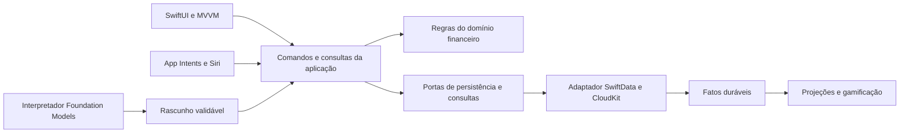

# Revisão: dados, abstrações e Apple Intelligence

Revisão inicial de 04/10/2026, após a migração MVVM. Os caminhos/linhas dos achados descrevem o código antes da implementação de entradas e saídas. Não foram examinados ou executados testes. Os achados abaixo distinguem defeitos atuais de limitações para funcionalidades futuras. A separação orçamento/transação, os comandos com Money, os filtros de categoria/tipo e o congelamento de V2 foram implementados posteriormente, conforme [financial-flows.md](financial-flows.md). Contas, obrigações, gamificação e integrações Apple continuam como propostas.

## Decisão principal

O núcleo financeiro precisa existir independentemente de orçamento, interface e inteligência. Hoje o domínio ainda representa principalmente despesas com orçamento. Acrescentar flags de receita, recompensa e dependência à mesma `TransactionEntity` aumentaria esse acoplamento.

Manter SwiftData e CloudKit é viável. O problema central é a definição dos agregados e das invariantes, não a escolha do banco. Os avanços atuais — domínio sem SwiftData, valores em centavos, consultas por perfil, paginação e schema versionado — devem ser preservados.

## Achados por prioridade

### P1 — O modo “Payer Based” não representa a dívida prometida pela interface

Em `TransactionAllocation.swift:65`, `.payerBased` atribui zero a todos os participantes. `Transaction.swift:153` anuncia que um participante paga e os demais ficam devendo. O picker oferece esse modo em `AddTransactionScreen.swift`, mas não há pagador explícito nem obrigação monetária separada. Uma despesa de R$ 100 com participantes nesse modo termina com R$ 100 atribuídos ao proprietário e zero aos demais; os resumos não podem cobrar as participações.

Antes de ampliar pagamentos ou dependentes, definir separadamente quem pagou, quem consumiu e quem deve a quem. O resultado esperado precisa ser uma alocação de consumo e uma obrigação liquidável. Até esse modelo existir, retirar a opção da criação ou tornar sua semântica explícita; não converter registros antigos automaticamente para divisão igual.

### P1 para a próxima migração — V2 depende de classes mutáveis do schema atual (corrigido)

`CashlySchema.swift:8` registra as classes de nível superior como o schema V2. Alterar essas mesmas classes para adicionar contas ou receitas altera também a definição histórica de V2. Isso compromete o reconhecimento e a migração de bancos que já foram gravados nessa versão.

Congelar os modelos exatos de V2 antes de introduzir V3, como já foi feito em V1. V3 deve ser uma nova definição, com etapas próprias. O atual `lightweight` V1 → V2 não transforma conceitos como usuário/contato, dívida/liquidação e orçamento/operação financeira.

### P2 — Transações dependem de orçamento para existir e identificar o proprietário (corrigido)

`Transaction.swift:13` exige um `Budget` completo; `Budget.swift:11` deriva o usuário da categoria. Em `CashlyRepository+Transaction.swift:84`, até gravar uma operação exige um orçamento válido e sem conflito. Uma receita de salário, uma transferência entre contas ou uma compra sem planejamento só caberia criando um orçamento artificial. Um conflito de planejamento também bloqueia o registro financeiro.

Introduzir proprietário explícito e independente no domínio, conta financeira e natureza da operação. Classificação e planejamento são associações opcionais. Resolver o orçamento deve afetar planejamento e projeções, sem ser pré-condição para registrar um fato financeiro. A compatibilidade da tela atual pode ser mantida por um adaptador durante a migração.

### P2 — Perfil, contato, rateio e liquidação têm responsabilidades sobrepostas

`Participant.swift:12` aponta para `User`, a mesma entidade que identifica o proprietário de categorias e orçamentos. `Participant.swift:15` usa o status da transação; `Transaction.swift:85` combina “a receber”, “a pagar”, “liquidado” e “cancelado”. Não existe identidade de conta, pagador, vencimento, recebimento parcial ou vínculo entre pagamentos e obrigações.

Um contato não deve se tornar perfil financeiro para participar de uma despesa. Uma dívida de R$ 100 paga em duas vezes precisa preservar obrigação de R$ 100, duas liquidações e saldo devedor, sem editar o valor original ou registrar novamente o consumo. Separar `FinancialProfile`, `Counterparty`, `ExpenseAllocation`, `Obligation` e `Settlement`. “Entrada” é tratada nesta proposta como receita; “dependência” abrange vínculos financeiros e isolamento das dependências de software. Dependentes familiares exigirão uma política adicional de membros e permissões.

### P2 — Referências duplicadas exigem reconciliação manual

`TransactionEntity.swift:17` guarda IDs de participantes; `ParticipantEntity.swift:23` guarda a transação inversa. `ParticipantEntity.swift:17` também copia nome e foto que o mapper normalmente obtém do usuário. Valores coexistem em `amount`, `amountSource`, `amountMinorUnits` e `ownerMinorUnits`. Algumas duplicações são necessárias para compatibilidade ou desempenho, mas não há uma fronteira estrutural clara entre dados canônicos, legado e projeção.

Escolher uma fonte de verdade por associação: por exemplo, `ExpenseAllocation.operationID`, e consultar suas linhas pelo índice. Campos de compatibilidade devem ficar no adaptador de migração; caches precisam de versão e reconstrução. A autoria explícita do agregado permite preservá-lo quando uma referência de classificação chega depois pelo CloudKit.

Não substituir todas as strings por `@Relationship` indiscriminadamente. Dentro de um agregado, uma relação pode ajudar a expressar ciclo de vida; entre contextos, referências por ID evitam carregar grafos e cascatas indesejadas. Documentar a política de remoção, resolução de referências pendentes e sincronização para cada ligação. No domínio, IDs tipados (`ProfileID`, `AccountID`, `OperationID`) impedem misturar identidades; a persistência pode continuar usando strings.

### P2 — O dashboard executa trabalho de inteligência sobre todo o histórico

`CashlyRepository+Queries.swift:171` calcula `datasetRevision` ao carregar o dashboard. O método de revisão, na linha 289, percorre o histórico completo, participantes, orçamentos e tags em uma leitura fria ou depois da invalidação do cache. O overview percorre o período solicitado. Tudo roda no mesmo `@ModelActor` (`CashlyRepository.swift:6`), também responsável pelas gravações.

A medição anterior, documentada em `validation.md`, registrou 12,096 s para carregar um perfil com 50 mil operações no mesmo período. Esse cenário sintético não mede percentis nem sincronização, mas confirma que paginação isolada não resolve a agregação. Filtros de categoria/tag/participante são aplicados depois de materializar lotes (`CashlyRepository+Queries.swift:115`); filtros esparsos podem percorrer muitos lotes para obter uma página.

Separar a consulta do dashboard da revisão de treinamento; carregar revisão apenas quando necessária. Criar projeções reconstruíveis por perfil/mês/categoria, atualizadas por alterações identificáveis, e consultas específicas para filtros comuns. Separar contextos de leitura e escrita somente depois de definir como cada leitura observa commits e importações remotas. Apenas criar mais actors não resolve consistência nem custo de consultas.

### P2 — A competência depende do fuso do dispositivo durante a gravação

`CashlyDomain.swift:9` usa `TimeZone.current`; `CashlyRepository+Transaction.swift:182` calcula o mês persistido a partir desse calendário. Ao editar a mesma operação próxima à virada do mês em outro fuso, a competência e o intervalo de parcelas podem mudar sem alteração do instante original. Perfis financeiros e recorrências precisam de regras temporais estáveis.

Separar instante de registro, data financeira civil, competência, vencimento e data de pagamento. Persistir a competência escolhida e uma política de fuso no perfil/agenda. Exibição pode acompanhar o dispositivo; edição não deve reagrupar automaticamente o histórico. Um `YearMonth` validado substitui inteiros soltos `yyyyMM` no domínio.

### P2 — O contrato de inteligência mistura treinamento com interpretação

`IntelligenceUseCase.swift:30` exige modelos persistidos, treinamento com transações completas e previsão em um único contrato. `LocalIntelligenceService.swift:6` implementa médias mensais e Naive Bayes, dentro de `CashlyData`. `IntelligenceViewModel.swift:55` condiciona previsões à revisão do treinamento. Nenhum fonte de produção importa `FoundationModels` ou `AppIntents`.

Foundation Models não deve ser encaixado como outro estimador que depende de `train()`. Separar capacidades: interpretação de texto/recibo, sugestão de categoria, explicação de resumo e previsão estatística. Cada entrada recebe apenas a projeção necessária; não o grafo financeiro inteiro. O serviço atual pode continuar como implementação estatística, com identidade de algoritmo e versão próprias.

### P2 para integrações — Inicialização e contexto financeiro dependem da janela

`CashlyApp.swift:72` prepara a sessão em uma `.task` de View. O bootstrap é privado e o perfil selecionado pertence à janela. Um intent executado em background não pode depender de essa tela existir ou adivinhar qual das janelas fornece autorização/contexto.

Criar uma raiz de composição de serviços com preparação assíncrona compartilhada, utilizável fora do SwiftUI. Injetar serviços com `AppDependencyManager`/`@Dependency` no adaptador App Intents. O perfil e a conta devem ser parâmetros resolvidos explicitamente; queries e comandos validam novamente o escopo. Registrar deps antes da execução do intent e retornar erros de preparação utilizáveis pelo sistema.

### P2 para gamificação — Invalidação de tela não é evento de negócio durável

`CashlyChangeHub.swift:22` usa `bufferingNewest(1)` e publica invalidação geral. Isso funciona para recarregar a interface, mas pode descartar sinais intermediários e não preserva significado, autoria ou resultado de uma operação. `Score.swift` descreve faixas de pontuação; não representa conquistas, progresso ou recompensas persistidos.

Gamificação deve consumir fatos confirmados, com ID e versão, de um registro durável salvo junto ao comando financeiro. Um consumidor idempotente atualiza progresso e conquistas; replay/importação CloudKit não concede a mesma conquista novamente. Correção ou cancelamento precisa de regra explícita para ajustar/revogar progresso. A pontuação de saúde financeira continua uma projeção separada.

### P3 — Moeda e contratos monetários limitam evolução (contrato monetário corrigido)

`Money.swift:6` fixa BRL no tipo; a gravação recebe `Double` (`CashlyRepository+Transaction.swift:46`) e o converte novamente em centavos. BRL é correto para o produto atual, mas o `currencyCode` persistido não constitui suporte a múltiplas moedas.

Comandos futuros devem receber `Money` já validado. Se contas em outras moedas entrarem no escopo, incluir moeda no valor e rejeitar soma entre moedas diferentes; câmbio é uma operação explícita com origem, destino e taxa. Evitar adicionar conversão implícita baseada no locale.

## Modelo de dados proposto

Proposta de núcleo com responsabilidades específicas; não são novas entidades já implementadas:

| Contexto | Entidades e dados canônicos | Fronteira |
| --- | --- | --- |
| Identidade financeira | `FinancialProfile`, `Counterparty`; posteriormente `ProfileMember` se houver família | Perfil identifica propriedade; contato identifica terceiros. Não equivale à identidade autenticada iCloud. |
| Caixa | `Account`, `FinancialOperation`, `AccountMovement` | Operação possui perfil, natureza, valor/moeda, data civil, estado, origem e chave de idempotência. Movimentos representam dinheiro efetivamente movimentado. |
| Consumo e classificação | `ExpenseAllocation`, `OperationClassification`, associação de tags | Rateio de consumo não é movimento de caixa. Categoria não exige orçamento. |
| Compromissos | `Obligation`, `Settlement`, agenda de parcelas/recorrências | Vencimentos e saldos a receber/pagar independem do consumo e de pagamentos realizados. Liquidação liga obrigação a movimento de caixa. |
| Planejamento | `BudgetPlan`, `BudgetPeriod` | Limites por perfil, período e categoria. Referencia classificação, sem possuir as operações financeiras. |
| Engajamento | `AchievementDefinition`, `AchievementGrant`, `GoalProgress` | Regras versionadas e progresso derivado de fatos financeiros confirmados. Não modifica saldos. |
| Projeções | `MonthlySummary`, dataset mínimo de previsões, catálogo de entidades para intents | Dados derivados, identificados por versão, descartáveis e reconstruíveis. |
| Entrega de fatos | registro de eventos/outbox + cursor por consumidor | Eventos com operação, revisão e perfil. Reprocessamento não duplica efeitos. |

Receita recebida gera movimento positivo na conta; despesa paga gera movimento negativo. Transferência possui dois movimentos vinculados, com soma zero na mesma moeda; operações cambiais exigem valores e taxa explícitos. Contas a receber ainda não liquidadas não aumentam saldo de caixa. O orçamento de consumo usa alocação e competência, evitando contar outra despesa quando chega um reembolso. O saldo inicial é um movimento de ajuste identificável, e o saldo atual é uma projeção.

Não presumir que transações antigas revelam contas, pagadores ou dinheiro já pago. A migração deve preservar fatos conhecidos e marcar os desconhecidos como tal. Adoção de contabilidade de partidas dobradas completa é uma decisão posterior se investimentos, passivos e reconciliação exigirem isso; o modelo atual não precisa dessa complexidade apenas para aceitar receitas.

## Abstrações que justificam seu custo

`CashlyApplication` deve coordenar comandos como `RecordExpense`, `RecordIncome`, `TransferBetweenAccounts` e `SettleObligation`, com entradas de IDs/valores e resultados específicos. Separar criação e atualização, incluir revisão esperada em edições e impedir que uma repetição da mesma chave crie outra operação. A mesma chave com payload diferente retorna conflito. SwiftUI, Siri e importação chamam os mesmos handlers.

`CashlyData` implementa portas por agregado e por consulta, preservando unidade de gravação onde há invariantes compartilhadas. Um repositório genérico CRUD não expressa “transferir duas contas atomicamente” ou “liquidar parte de uma obrigação”. O atual gateway de muitos protocolos pode continuar como compatibilidade temporária; o destino é injeção pelo construtor de capacidades menores, sem acesso livre à factory por todos os serviços.

`CashlyIntelligence` deve isolar implementações Apple e estatísticas; `CashlyIntents` isola tipos e metadados Apple. Esses são limites propostos. Extrair módulos conforme tenham um consumidor real, evitando pacotes vazios ou um protocolo para cada classe. O domínio continua sem SwiftUI, AppIntents, FoundationModels e SwiftData.

| Pattern | Aplicação concreta |
| --- | --- |
| Adapter | SwiftData ↔ domínio, AppEntity ↔ projeção consultável, resposta gerada ↔ rascunho. |
| Command | Operações reutilizadas por formulário, Siri e importação, com validação e idempotência. |
| Strategy | Políticas de rateio, classificação e recorrência quando houver alternativas reais. Enums e funções bastam para casos simples. |
| Observer | Invalidação de UI; eventos duráveis para consumidores que não podem perder fatos. |
| Facade / raiz de composição | Preparar serviços e expor capacidades da aplicação, sem virar um service locator global. |

Essa aplicação dos patterns é uma decisão de projeto, apoiada pelos problemas encontrados. O [catálogo indicado](https://refactoring.guru/pt-br/design-patterns) é referência de conceitos, não uma exigência de aplicar todos os padrões. Evitar EAV/tabela universal de atributos, herança de entidades financeiras, event sourcing completo e um framework de dependências antes de haver necessidade concreta.

## Siri, App Intents e Foundation Models no SDK 27

São duas integrações distintas: App Intents expõe dados e ações para o sistema; Foundation Models oferece interpretação/geração dentro do app. Um intent com parâmetros estruturados não precisa de LLM para gravar uma despesa. A Apple apresenta esse contrato de descoberta em [App Intents](https://developer.apple.com/documentation/appintents).

### App Intents

Começar por consultar resumo mensal, abrir uma operação e preparar uma despesa. `AppEntity` representa perfil, conta, categoria e operação com ID estável e propriedades mínimas. `EntityQuery`/`EntityStringQuery` resolvem nomes dentro do escopo permitido; IDs removidos ou ambíguos retornam ausência/desambiguação, sem escolher o primeiro registro global. Usar `IndexedEntity` apenas para conteúdo deliberadamente indexável, com atualização/remoção quando os dados mudarem.

App Shortcuts pode fornecer frases de ativação. Não prometer entendimento arbitrário de qualquer comando financeiro: as capacidades semânticas de Siri dependem também de schemas suportados. O SDK local possui `AppSchema` e macros `@AppIntent(schema:)`/`@AppEntity(schema:)`; não foi encontrado um domínio público financeiro na interface inspecionada. Usar intents próprios e atalhos para essas ações, e adotar um schema somente quando ele corresponder de fato à função. Referência: [App Schemas no WWDC26](https://developer.apple.com/videos/play/wwdc2026/240/).

Definir `supportedModes` por ação, sem acoplar handlers ao router. Consultas podem executar em background; edição pode produzir um rascunho e abrir a tela apropriada. A navegação recebe IDs e perfil, escolhe uma cena e mantém as pilhas do router existentes. Não usar `openAppWhenRun` como base de novos intents: está deprecado no SDK inspecionado. Referência: [comportamento em execução](https://developer.apple.com/documentation/appintents/configuring-the-runtime-behavior-of-your-app-intents).

Definir autenticação para dados financeiros e distinguir autenticação, confirmação e autorização do perfil. O padrão de `authenticationPolicy` permite execução com dispositivo bloqueado; a política financeira não deve depender desse padrão. Gravações explícitas usam comando validado e resultado verificável; alterações ambíguas pedem parâmetros/confirmam o rascunho. Referência: [authenticationPolicy](https://developer.apple.com/documentation/appintents/appintent/authenticationpolicy).

### Foundation Models

O primeiro caso útil é interpretar “gastei R$ 42,90 no mercado ontem” em um rascunho estruturado e sugerir classificação. Usar `@Generable`/`@Guide` no adaptador, sem exportar os tipos gerados para o núcleo. Geração estruturada garante formato, não a veracidade do valor, data ou destinatário. Resolver categoria/conta no catálogo permitido, validar centavos/data e deixar dúvidas visíveis. Resumos usam totais produzidos pelo domínio; o modelo só redige a explicação.

Verificar `SystemLanguageModel.availability` em runtime; ter formulário manual e classificador local como alternativas. Sessões pertencem ao pedido/perfil e não devem compartilhar transcript entre perfis. Aplicar cancelamento, limite de contexto, tratamento de recusa/erro e versão de prompt. A Apple recomenda verificar disponibilidade e descreve limitações, inclusive de matemática, em [geração com Foundation Models](https://developer.apple.com/documentation/foundationmodels/generating-content-and-performing-tasks-with-foundation-models).

Novidades verificadas no SDK 27 e documentação: `LanguageModel`, `LanguageModelSession.DynamicProfile`, instruções dinâmicas e entrada multimodal. Perfis dinâmicos permitem configurar instruções, tools e modelo por fase; usá-los quando houver fluxo de extração/revisão/explicação, sem exigir um sistema multiagente para preencher um formulário. Tools começam com consultas limitadas e escopadas; o executor do domínio controla qualquer gravação. Referência: [Foundation Models no WWDC26](https://developer.apple.com/videos/play/wwdc2026/242/).

`PrivateCloudComputeLanguageModel` está disponível a partir de 27 nas plataformas do projeto, mas depende de elegibilidade e do entitlement gerenciado `com.apple.developer.private-cloud-compute`. Há disponibilidade, rede e quota a tratar. Portanto, manter um adaptador opcional para PCC, sem adicioná-lo como dependência obrigatória do produto nem ativar capabilities sem elegibilidade. Referência: [PCC e requisitos](https://developer.apple.com/documentation/foundationmodels/adding-server-side-intelligence-with-private-cloud-compute).

## Ordem de execução recomendada

1. Congelar V2; registrar invariantes de caixa, consumo, obrigação e propriedade. Resolver a semântica de `payerBased`. Definir IDs e datas financeiros.
2. Introduzir comandos/consultas de aplicação e uma raiz de composição independente de View. Migrar os formulários atuais para os handlers, mantendo adaptadores de compatibilidade.
3. Criar V3 aditivo com perfil/contato, operações independentes de orçamento e classificação. Mapear IDs antigos de forma determinística, registrar o progresso e permitir retomada sem duplicações. Valores/referências indefinidos permanecem preservados e identificados para resolução.
4. Acrescentar contas/movimentos e receitas; depois obrigações/liquidações e recorrências. Não inventar saldo inicial, pagador ou pagamento a partir do status legado.
5. Separar revisão de treinamento do dashboard, projetar agregados e índices por consulta. Validar totais por reconstrução e diagnosticar latência com o volume já documentado, incluindo perfis com participantes.
6. Introduzir eventos duráveis e consumidores idempotentes; implementar metas/conquistas sobre esses fatos. Definir política de exclusão, estorno, replay e versões de regras.
7. Expor consultas e rascunhos via App Intents; em seguida gravações com parâmetros completos. Integrar interpretação Foundation Models pelo mesmo pipeline de rascunho/comando. PCC fica condicionado à elegibilidade.

Migração não deve apagar o banco ou assumir que CloudKit importa todos os registros relacionados de uma vez. Preservar referências pendentes, revisar clientes antigos que escrevem campos legados e planejar publicação do schema CloudKit por ambiente. Eventos, comandos e projeções precisam de reconciliação determinística em importações/replays; uma gravação local atômica não é uma transação distribuída.

Critérios de entrega de cada etapa: dados antigos preservados; nenhuma operação duplicada ao retomar; receita sem orçamento; transferência sem inflar receita/despesa; pagamento parcial sem repetir consumo; queries e intents respeitando perfil; gamificação reprocessável; funcionalidade manual disponível sem Apple Intelligence. Nesta fase, esses critérios serão acompanhados por compilação, inspeção e diagnósticos manuais, conforme a orientação de deixar testes fora do escopo.

## Alterações desta revisão

Os deployment targets existentes foram elevados para 27 em Debug/Release (iOS/iPadOS, macOS e visionOS) e no manifesto SwiftPM. Isso encerra suporte às versões anteriores. Não foram criados targets watchOS/tvOS.

Ao compilar visionOS, foi encontrado uso de `SwiftUI.Glass` e `glassEffect`, indisponíveis nessa plataforma. A correção criou `CashlySurface`/`CashlySurfaceContainer` no design system: as telas informam cor, forma e interação, e o adaptador usa Liquid Glass em iOS/macOS e `glassBackgroundEffect` nativo em visionOS. O tipo Apple `Glass` deixou de fazer parte do contrato das telas.

O script de compilação passou a compilar o app Production nas três plataformas; o workflow usa a imagem `xcode-27`, anunciada oficialmente como preview pelos [maintainers das imagens do GitHub](https://github.com/actions/runner-images/issues/14404). O workflow remoto ainda requer publicação e execução. A atualização de target não cria integrações Siri/Foundation Models. A alteração posterior do banco para V3 e a inclusão de entradas estão detalhadas em [financial-flows.md](financial-flows.md).
