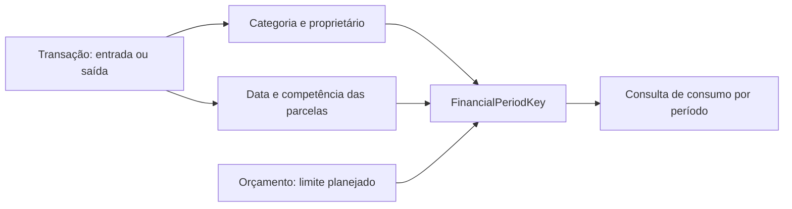

# Entradas, saídas e planejamento por período

Implementado em 04/10/2026, seguindo a orientação de desacoplar orçamento e transação.

## Modelo atual

`Transaction` possui proprietário explícito, categoria, tipo (`expense`/`income`), valor positivo em centavos BRL, data, status e informações de parcelas/rateio. Não possui `Budget`, `budgetID` ou orçamento obrigatório. Os comandos recebem `categoryID`, `TransactionKind` e `Money`, em vez de snapshots de orçamento e valores monetários em `Double`.

`Budget` continua representando planejamento por categoria e mês. A associação de leitura usa `FinancialPeriodKey(ownerID, categoryID, month)`. O mês representa a competência da operação ou da parcela. Cada orçamento recebe apenas o consumo das saídas correspondentes; entradas não compensam consumo orçamentário.

Criar, editar ou excluir um orçamento não reescreve lançamentos. Uma operação pode existir antes de haver planejamento; adicionar o orçamento depois faz o consumo aparecer na consulta do mês/categoria correspondentes. Conflictos de orçamento afetam o planejamento, sem bloquear lançamentos válidos. A resolução de conflitos não remapeia transações.

O mapper de transações consulta categorias e participantes, sem buscar orçamentos ou percorrer aliases. Os filtros de categoria e tipo são aplicados na consulta persistida. A associação de orçamento usa um índice em memória por chave do período, evitando comparar cada transação com todo o histórico de orçamentos.

## Comportamento de entrada

Entradas são suportadas nos contratos do domínio, na persistência, nas consultas e nos cálculos. O layout anterior foi preservado: não há seletor de entrada/saída, filtros de tipo, novos indicadores ou rótulos na listagem. O formulário existente continua criando saídas por padrão; criar entradas exige um consumidor dos contratos, sem interface nova nesta etapa.

O resultado é a diferença entre lançamentos válidos de entrada e saída no período, incluindo a competência das parcelas. Não representa saldo bancário conciliado: ainda não há contas ou liquidações independentes. Lançamentos cancelados têm contribuição zero. Status “a receber” não é o mesmo conceito que tipo entrada; o tipo é explícito e não é inferido do status.

Rateio entre participantes continua sendo uma capacidade das saídas. O domínio de gravação rejeita entrada com participantes. Entradas podem possuir parcelas, usando a mesma distribuição determinística em centavos. As previsões de gastos são treinadas exclusivamente com saídas; a seleção de categoria por esse classificador permanece restrita às saídas.

O rascunho de transação mantém catálogo de categorias e tags, independentemente de mês/orçamento. O ViewModel preserva o tipo ao editar um lançamento existente. Os avisos de planejamento e indicadores anteriores continuam sendo informações de apresentação, sem tornar orçamento obrigatório para gravar a transação. A remoção de categoria é bloqueada quando existem lançamentos que a utilizam, inclusive quando não há orçamento.

## Migração V3

V1 e V2 possuem layouts históricos congelados. V3 adiciona `categoryID` e `kind` ao armazenamento de transação; registros antigos assumem `expense` (valor bruto 0), preservando a interpretação de despesas já existente. A migração de estrutura é aditiva V1 → V2 → V3, seguida da normalização dos dados.

A normalização extrai categoria/proprietário do vínculo antigo quando necessário. Referências ainda não recebidas pelo CloudKit continuam preservadas e são resolvidas depois. A coluna legada `TransactionEntity.budget` permanece no schema para compatibilidade de armazenamento, usada apenas como entrada de migração. Gravações novas deixam essa coluna vazia; domínio, formulários, consultas de operações e consumo orçamentário não a usam como relacionamento.

Excluir um orçamento exige que seus registros legados pendentes possam ser normalizados, evitando perder a única informação que permite recuperá-los. Orçamentos com aliases históricos de resolução conservam a proteção existente; a remoção de todos os orçamentos elimina também esses registros de planejamento, preservando transações já normalizadas.

Não apagar stores para migrar. Publicação do schema CloudKit e coexistência com clientes antigos precisam de verificação em dispositivos assinados. Clientes antigos que continuam editando o vínculo legado podem divergir da classificação independente de V3; não há promessa de edição bidirecional entre essas arquiteturas.

## Abstração das plataformas

Os targets existentes são iOS/iPadOS, macOS e visionOS 27. APIs indisponíveis em visionOS foram isoladas no design system: superfícies de vidro, botões destacados, espaço de toolbar e comportamento de teclado. As telas usam os adaptadores `cashlySurface`, `CashlySurfaceContainer`, `cashlyProminentButton`, `CashlyToolbarSpacer` e `cashlyDismissKeyboardOnScroll`.

## Verificação automatizada

`CashlyDataTests` (`FinancialFlowTests`), `FeatureCoreTests` e os `Feature…Tests` usam um banco em memória, sem tocar no banco do usuário. Verificam criação sem orçamento, associação por competência, alteração/remoção de planejamento, entrada/saída, cancelamento, isolamento de perfil e criação/edição pelo ViewModel. Também confirmam que entradas não participam das amostras do estimador de despesas.

Os testes verificam R$ 1.200,05 de entrada, R$ 133,35 de saída no primeiro mês e R$ 1.066,70 de resultado. Uma saída de R$ 100,01 em três parcelas gerou R$ 33,34 / R$ 33,34 / R$ 33,33. Todos os lançamentos permaneceram após excluir o orçamento.

As migrações foram executadas em cópias dos fixtures V1 e V2: preservaram 2 usuários, 1 categoria, 1 orçamento, 1 tag, 1 transação e 1 participante, sem referências pendentes. O valor original de 10.001 centavos permaneceu igual à soma dos rateios, e as parcelas do proprietário somaram seus 5.001 centavos. Os diagnósticos existentes de tags, conflitos, isolamento e preview também passaram.

Os comandos de build e limites de validação estão em [validation.md](validation.md). Testes ficaram fora do escopo. O review de abstrações e as propostas de Siri, App Intents, Foundation Models, contas, obrigações e gamificação continuam em [data-and-intelligence-review.md](data-and-intelligence-review.md); essas integrações e entidades futuras não foram implementadas nesta etapa.
