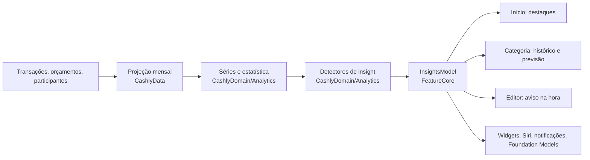

# Dados e análises

Como transformar os dados que o Cashly já guarda em informação útil sobre o passado, o presente e o futuro, sem quebrar a separação por feature. Parte do [roadmap](roadmap.md).

## O que os dados permitem hoje

| Dado | Onde está | O que revela |
| --- | --- | --- |
| Transação: valor, tipo (entrada ou saída), data, categoria, tags, descrição | `Transaction` | Quanto, quando, em quê, com que frequência |
| Status: pendente a pagar, pendente a receber, pago, cancelado | `TransactionStatus` | Compromissos em aberto |
| Parcelas | `paymentsPlan` + `billingMonths` | Dinheiro já comprometido nos próximos meses |
| Participantes, divisão e status de cada um | `Participant` | Quem deve a quem |
| Orçamento por categoria e mês | `Budget` | Intenção da pessoa, que dá para comparar com o realizado |
| Descrição livre | `summary` | Recorrências (mesmo texto todo mês) e estabelecimentos |

**Limites atuais:**
- **Um mês por vez:** `CashlyOverview` resume só o mês filtrado. Não existe série mensal disponível para as telas.
- **Série escondida:** a única série histórica (somas por categoria e mês) fica dentro do `LocalIntelligenceService`, gravada no arquivo do modelo e só atualizada quando a pessoa toca em "Treinar".
- **Previsão simples:** média dos últimos 6 meses, sem tendência, sem tratar valores atípicos e sem faixa de confiança.
- **Uma só data:** a transação tem um único `date`. Não separa compra, vencimento e pagamento, o que limita fluxo de caixa e atrasos.

## Proposta: uma base de análise compartilhada

Três camadas, cada uma no seu lugar da arquitetura:

### 1. Projeção mensal (`CashlyData`)

Uma tabela derivada por pessoa × mês × categoria (e tag) com:
- gasto, receita e orçamento;
- quantidade de transações;
- pendentes a pagar e a receber;
- parcelas que caem naquele mês.

Características:
- **Reconstruível:** sai das transações e é refeita quando o `datasetRevision` muda.
- **Uma leitura:** um `AnalyticsRepository` entrega 12, 24 ou 36 meses de uma vez.
- **Resolve um item do backlog:** é a "agregação proporcional ao volume" (P2). O resumo para de reler todas as transações a cada abertura.
- **Fonte única:** vale para gráficos, previsões e inteligência. O serviço de inteligência deixa de manter a própria soma por mês.

### 2. Séries e estatística (`CashlyDomain/Analytics`)

Funções puras e testáveis sobre a projeção:
- média e mediana móveis;
- tendência;
- desvio, para a faixa de confiança;
- comparação no mesmo ponto do mês ("até o dia 10");
- detecção de valores atípicos;
- detecção de recorrência (mesma categoria e descrição parecida, valor próximo, intervalo regular).

Nada aqui depende de SwiftUI nem do banco.

### 3. Insights como tipo do domínio

O `Insight` é um valor:
- tipo, período e relevância;
- números calculados;
- evidências (IDs das transações);
- a `Route` para agir.

Cada regra é um detector pequeno e testável, que recebe séries e devolve insights. Um ranqueador ordena por relevância: tamanho do valor, urgência, novidade e se a pessoa já dispensou aquele insight.

**Por que encaixa na arquitetura:**
- o cálculo fica em um lugar só (Domain e Data);
- cada feature só **mostra** os insights que lhe dizem respeito, por um `InsightsModel` compartilhado no `FeatureCore`;
- Foundation Models, widgets e Siri usam a mesma fonte;
- o modelo de linguagem **narra**, não calcula: os números vêm sempre do motor determinístico.

## Catálogo de insights

### Passado: o que aconteceu

| Insight | Exemplo | Dados |
| --- | --- | --- |
| Evolução mensal | Gráfico de 12 meses de gasto, receita e saldo | Projeção |
| Comparação justa | "Até o dia 10 você gastou R$ 1.200; no mês passado, até o dia 10, R$ 950" | Transações por dia |
| Categoria fora do padrão | "Delivery está 38% acima da sua média de 3 meses" | Projeção + média móvel |
| Taxa de poupança | "Você guardou 18% da renda em setembro (média: 12%)" | Receita e gasto |
| Orçamento realista | "Mercado estourou em 4 dos últimos 6 meses; um orçamento de R$ 1.150 seria realista" | Orçamento × realizado |
| Custo de eventos | "A viagem (tag) custou R$ 3.400 no total" | Tags |
| Recorrências | "Você tem 7 gastos que se repetem todo mês: R$ 420/mês" | Descrição + intervalo |

### Agora: como está o mês

| Insight | Exemplo | Dados |
| --- | --- | --- |
| Ritmo do mês | "No ritmo atual, você termina o mês em R$ 4.800 (orçamento: R$ 4.000)" | Gasto até hoje ÷ fração do mês |
| Quanto posso gastar | "Você pode gastar R$ 85 por dia até o fim do mês" | Orçamento restante ÷ dias restantes |
| Alerta antecipado | "Lazer já usou 80% do orçamento, e ainda faltam 18 dias" | Uso × dia do mês |
| Contas da semana | "3 contas vencem até domingo: R$ 640" | Pendentes a pagar com data |
| A receber atrasado | "Ana te deve R$ 120 desde 12/09" | Participantes e pendentes a receber |
| Gasto atípico | "R$ 890 em Mercado é 4× o seu normal; confere?" (também pega erro de digitação) | Mediana da categoria |
| Sem orçamento | "Você gastou R$ 600 em Pets sem orçamento; criar um?" | Categoria sem `Budget` |

### Futuro: o que vem

| Insight | Exemplo | Dados |
| --- | --- | --- |
| Compromissos já assumidos | "Você já tem R$ 2.300 comprometidos em parcelas até março" | `paymentsPlan`, **sem estimativa: é certo** |
| Fim do mês projetado | Ritmo + recorrências que ainda vão cair + pendentes | Projeção + recorrências |
| Próximo mês por categoria | "Mercado: entre R$ 980 e R$ 1.150" (faixa, não número mágico) | Média ponderada + desvio |
| Orçamento sugerido | Ao criar o orçamento de outubro, sugerir pela previsão | Previsão por categoria |
| Fluxo de caixa | Saldo projetado (receita − gasto) nos próximos 3 meses | Recorrências + parcelas + pendentes |
| E se | "Cortar 20% do delivery economiza R$ 1.100 por ano" | Média da categoria |
| Metas (futuro) | "No ritmo atual, a reserva fica pronta em julho" | Metas + taxa de poupança |

## Previsão: o que muda em relação a hoje

- **Sem "Treinar":**
  - Previsões de valor são estatística sobre a projeção, calculada na hora a partir da série de cada mês.
  - O treino continua só para sugestão de categoria (Naive Bayes), e pode rodar sozinho em segundo plano quando o `datasetRevision` muda.
  - Isso tira a tela de treino do caminho da pessoa.
- **Ordem de confiança:**
  1. o que é certo (parcelas e pendentes);
  2. o que é recorrente;
  3. o que é estimado (média, tendência).
- **Mostrar a incerteza:** faixa em vez de valor único. Com menos de 3 meses de dados, dizer "ainda aprendendo seus gastos" em vez de inventar.
- **Separar o atípico:** um gasto fora do normal (TV nova) não deve puxar a previsão do mês seguinte. Usar mediana ou excluir valores atípicos.

## Onde cada coisa aparece

- **Início:** "Destaques" com 2 ou 3 insights do momento (ritmo, compromissos, um alerta), que a pessoa pode dispensar.
- **Detalhe da categoria:** 12 meses, média, previsão com faixa e orçamento sugerido.
- **Editor de transação:** aviso na hora ("Isso usa 40% do que resta em Mercado", "Valor 4× o normal").
- **Planejamento:** orçamento sugerido e categorias que sempre estouram.
- **Notificações, widgets e Siri:** "Quanto posso gastar hoje?", resumo semanal e alerta de ritmo, usando o mesmo motor.
- **Foundation Models:** transforma uma lista de `Insight` em texto e responde perguntas chamando o `AnalyticsRepository` como ferramenta.

## Dados que valeria começar a guardar

Para análises melhores, em ordem de impacto:
1. **Vencimento e data de pagamento** separados da data da compra (já está no backlog como "competência"). Permite fluxo de caixa e atrasos reais.
2. **Recorrência explícita:** a pessoa marca "repete todo mês". Isso completa a detecção automática.
3. **Estabelecimento normalizado**, separado da descrição livre. Vem de graça com Wallet, comprovante e Foundation Models.
4. **Data de criação do registro:** mede o hábito (sequências, gamificação) sem depender da data da compra.
5. **Insights dispensados ou úteis:** guardados localmente, para o ranqueamento aprender o que importa para a pessoa.

## Ordem sugerida

1. **Base:** a projeção mensal no `CashlyData` + `AnalyticsRepository` + séries no Domain, com testes. Nada muda na tela ainda, e o resumo do mês fica mais rápido.
2. **Certezas e presente:**
   - compromissos de parcelas;
   - ritmo do mês e quanto posso gastar;
   - contas da semana e quem te deve.
   Tudo é determinístico, de baixo risco e alto valor.
3. **Comparações:** contra a média, no mesmo ponto do mês, gasto atípico e categoria sem orçamento.
4. **Recorrências:** detecção, "suas assinaturas" e uso nas projeções.
5. **Previsão nova:** faixa de confiança e orçamento sugerido, sem treino manual.
6. **Narrativa:** Foundation Models sobre os insights prontos.
