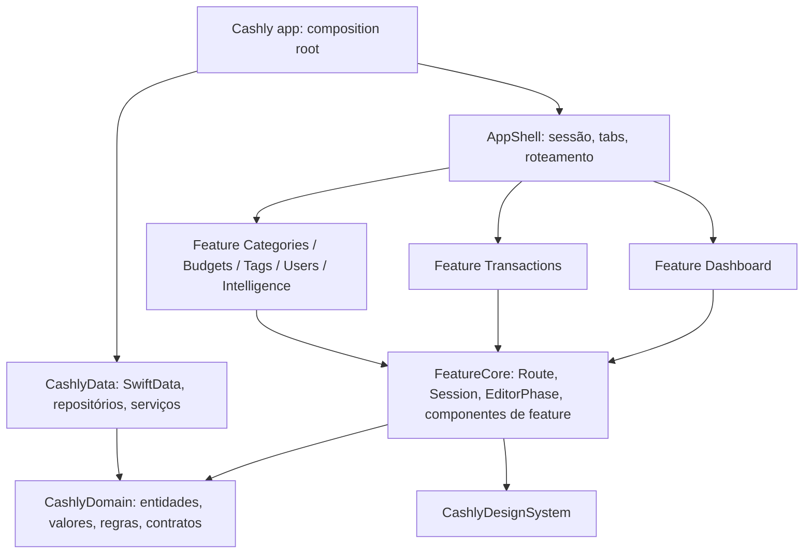

# Plano de refatoração: arquitetura enxuta SwiftUI-native

Proposta de 08/10/2026. Parte do working tree atual do branch `refactor/swiftui-ui-patterns`.

## Objetivo

Simplificar para escalar: adicionar uma feature nova deve ser seguir uma receita, sem precisar entender o resto do app.

- Cada feature isolada em seu próprio módulo, sem enxergar as outras.
- Poucos patterns, sempre os mesmos, cada um com um lugar fixo.
- Cada regra de negócio em um único lugar, testada.

Hoje o fluxo de uma ação atravessa `View → MainViewModel → CashlyDataFactoryProtocol.scoped(to:) → CashlyScopedRepository (7 protocolos) → CashlyRepository (actor de ~1.300 linhas)`, e as regras ficam espalhadas entre o repositório (agregação, conflitos), o `MainViewModel+Summary` (score, variação) e as telas (conflito no formulário de transação, dados de gráfico).

## O que não muda

A refatoração é estrutural. Estas decisões estão corretas e serão preservadas:

- `CashlySchemaV1`/`V2` congelados, `CashlyMigrationPlan` e a normalização em `prepare`. Nenhuma alteração no layout persistido.
- `Money` em centavos `Int64`, alocação determinística de centavos e parcelas.
- Um único `@ModelActor` dono do `ModelContext`, para salvar transação + participantes atomicamente.
- Escopo de usuário por janela, imutável; seleção de uma janela não afeta outra.
- Descarte de respostas antigas por revisão/cancelamento e o `ChangeHub` para invalidação.
- Navegação (`CashlyNavigation`, `MainRoute`, `open(_:in:)`): está boa e só será movida de lugar.

## Arquitetura alvo



Features não dependem umas das outras. Quando o Dashboard precisa abrir o editor de transação, ele chama `open(.transactionEditor(id:))`; quem sabe qual tela corresponde a cada rota é só o `AppShell`. O compilador garante o isolamento: um import entre features não compila.

| Camada | Responsabilidade | Não pode |
| --- | --- | --- |
| Domain | Entidades, value types (`Money`, `YearMonth`), regras puras (score, agregação, parcelas, conflitos) e protocolos de repositório | Importar SwiftUI/SwiftData; formatar texto de UI; ter extensions públicas em tipos da stdlib |
| Data | Persistir, consultar, mapear `@Model` ↔ entidade, sincronizar, treinar modelos locais | Calcular regra de negócio que não dependa do banco |
| FeatureCore | Contratos compartilhados entre features: `Route`, `open`, `Session` (usuário e repositórios da janela), `EditorPhase`, formatters | Conter tela ou model de uma feature específica |
| Feature* | Telas, `@Observable` models e drafts de uma feature | Importar outra feature; acessar `ModelContext` |
| AppShell | Tabs, pilhas de navegação, mapa rota → tela, sessão da janela | Ter regra de negócio ou estado de feature |
| App | Criar store, repositórios e sessão; injetar | Ter lógica |

### Patterns e onde ficam

Um conjunto pequeno e fixo. Qualquer código novo se encaixa em um destes; se não encaixa, é sinal para discutir antes de inventar outro.

| Pattern | Papel | Onde | Exemplo |
| --- | --- | --- | --- |
| Entity / Value Object | Dados e invariantes do negócio | `Domain/Entities`, `Domain/Values` | `Transaction`, `Money`, `YearMonth` |
| Domain Service (regra pura) | Cálculo sem I/O, testável sem banco | `Domain/Rules` | `BudgetHealth`, `OverviewAccumulator` |
| Repository | Acesso a dados por agregado, escopado ao usuário | protocolo em `Domain/Repositories`, implementação em `Data/Repositories` | `TransactionRepository` / `SwiftDataTransactionRepository` |
| Adapter (Mapper) | `@Model` ↔ entidade | `Data/Mapping` | `TransactionMapper` |
| Observable Model | Estado de tela + intenções | `Feature*/` | `TransactionEditorModel` |
| Draft | Campos editáveis + validação, sem SwiftUI | `Feature*/` | `TransactionDraft` |
| Router (Coordinator) | Navegação por rota, sem telas se conhecerem | `Route` em `FeatureCore`, mapa em `AppShell` | `open(.categoryDetail(id:))` |
| Composition Root + DI por init | Montar dependências uma vez | `App` e `Session` | `Session(scope:)` cria repositórios do usuário |
| Observer | Invalidação após escrita/sync | `Data/Services/ChangeHub` | models recarregam ao receber evento |

### Receita: adicionar uma feature

Exemplo: uma feature "Metas".

1. **Domain**: `Entities/Goal.swift`, `Repositories/GoalRepository.swift` (protocolo) e, se houver cálculo, `Rules/GoalProgress.swift` com teste.
2. **Data**: `@Model GoalEntity` em um novo schema versionado, `GoalMapper`, `SwiftDataGoalRepository`. Registrar no `Session`.
3. **Feature**: target `FeatureGoals` com `GoalListModel`, `GoalEditorModel`, `GoalDraft`, `GoalListScreen`, `GoalEditorScreen`. Depende só de `FeatureCore`.
4. **Rotas**: adicionar `case goalEditor(id:)` em `Route`, mapear no `AppShell`, e se for aba, um `case` em `AppSection`.
5. **Testes**: regra no Domain, repositório com store em memória, model com repositório fake.

Nada fora dessas cinco etapas precisa ser tocado.

### Estrutura de pastas

```
CashlyKit/Sources
├── CashlyDomain
│   ├── Values/          Money, YearMonth, TransactionAllocation
│   ├── Entities/        User, Category, Tag, Budget, Transaction, Participant (+ enums)
│   ├── Rules/           BudgetHealth, OverviewAccumulator, BudgetConflictDetector, Installments
│   ├── Repositories/    UserRepository, CategoryRepository, TagRepository,
│   │                    BudgetRepository, TransactionRepository, DashboardRepository
│   ├── Intelligence/    IntelligenceService (protocolo) e tipos
│   └── DomainError.swift
├── CashlyData
│   ├── Store/           CashlyStore (@ModelActor), Schema V1/V2/V3, Migration, Normalization
│   ├── Entities/        @Model
│   ├── Mapping/
│   ├── Repositories/    SwiftData*Repository (structs finas sobre o store, com userID fixo)
│   └── Services/        ChangeHub, LocalIntelligenceService, Metrics
├── FeatureCore          Route, AppSection, open, Session, EditorPhase, formatters, componentes de feature
├── FeatureDashboard     DashboardModel, HomeScreen e seções
├── FeatureTransactions  TransactionListModel, TransactionEditorModel, TransactionDraft, telas
├── FeatureCategories    (inclui detalhe de categoria)
├── FeatureBudgets       (inclui resolução de conflito)
├── FeatureTags
├── FeatureUsers
├── FeatureIntelligence
├── AppShell             RootView, MainScreen, tabs, mapa rota → tela
├── CashlyDesignSystem
├── CashlyResource
└── CashlyMock / CashlyPreview / CashlyAudit
```

`CashlyPresentation` e `CashlyUI` deixam de existir. Cada feature é um target com model, draft, telas e previews juntos. Encontrar "onde está o formulário de transação" passa a ser abrir `FeatureTransactions/`. Cada feature pode ter seu target de teste.

## Fases

Cada fase termina com: `scripts/build.sh Debug` passando, `scripts/lint.sh` passando, testes verdes, app aberto no simulador com os fluxos principais conferidos, e um commit próprio.

### Fase 0: checkpoint

Concluída: `f63f0b8`.


- Commit do working tree atual (137 arquivos) como está, para ter um ponto de retorno.
- Rodar build e lint e registrar o estado de partida.
- Corrigir ou remover `BudgetActorTests`/`CommonTestSuite`, que não acompanham a API atual.
- Remover os comentários restantes e adicionar a regra de lint que os proíbe.

### Fase 1: fundação do Domain

Concluída. `Score` foi para `FeatureCore` e terá suas regras extraídas na fase 2. Entidades deixaram de ser `Codable`; mocks passaram a ser `SampleData` em Swift.


- Criar `YearMonth` (struct com `year`/`month`, aritmética de meses, `Comparable`) e substituir os `Int` de competência (`Budget.date`, `TransactionQuery.month`, `billingStartMonth`, `occurs(in:)`).
- `Transaction.date` vira `Date`; a conversão de `TimeInterval` fica no mapeamento de Data.
- `TransactionQuery.statuses` vira `Set<TransactionStatus>`.
- Remover as extensions públicas em `BinaryInteger`, `Double`, `String`, `Data`, `Encodable`, `Sequence` de `CashlyDomain.swift`; formatação de moeda/percentual vai para `FeatureCore`.
- Tirar textos de UI do Domain (`TransactionStatus.summary`, `TransactionSplitMode.description`, `TransactionKind.title`, `shareMessage`): passam a ser extensions de apresentação em `FeatureCore`.
- Remover `User.empty`/`Participant.empty` e `selfFirstName`.
- Mover cada protocolo para seu arquivo (hoje `DashboardUseCase` está em `TransactionQuery.swift`, `SnapshotUseCase` em `CashlySnapshot.swift`).
- Testes: `Money`, `TransactionAllocation`, parcelas, `YearMonth`.

### Fase 2: regras de negócio no Domain

Concluída. Além do previsto, `BudgetUsage` concentra a razão gasto/orçamento e os estágios de uso, antes repetidos em seis pontos da UI.


- `BudgetHealth`: score, variação, restante, categorias em alerta (hoje em `MainViewModel+Summary`).
- `OverviewAccumulator`: struct que recebe lotes de transações/orçamentos e produz `Overview`. O repositório continua lendo em lotes de 500 e só alimenta o acumulador (hoje tudo dentro de `CashlyRepository+Queries.overview`).
- `BudgetConflictDetector`: detecção por usuário/categoria/mês (hoje duplicada entre `catalog` e `MainViewModel.budgetConflict`).
- Testes para as três regras.

### Fase 3: repositórios por agregado

Concluída. `CashlyDatabase` implementa `RepositoryProvider`; `CashlyStore` é o actor único; cada repositório é uma struct sobre `StoreScope`. Os antigos diagnósticos `flows` e `scenarios` do `CashlyAudit` viraram `CashlyDataTests` e `CashlyPresentationTests`.


- Trocar os 7 protocolos `*UseCase` (CRUD com 12 parâmetros) por repositórios que recebem entidades:

  ```swift
  public protocol TransactionRepository: Sendable {
      func transaction(id: Transaction.ID) async throws -> Transaction?
      func save(_ transaction: Transaction) async throws
      func delete(ids: Set<Transaction.ID>) async throws
  }
  ```

- O escopo de usuário fica só na construção do repositório. Saem os parâmetros `user:`/`userID:` redundantes e os `guard user == scope`.
- Remover APIs sem uso na interface (`getTransactions()` sem filtro, `removeUsers()`, `getBudgets(categories:date:)` etc.), mantendo o que `CashlyAudit` e treino usam.
- `CashlyRepository` vira `CashlyStore`: só transações de banco (fetch, require, commit, normalização). Cada `SwiftData*Repository` é uma struct com `store` + `userID`.
- Remover `CashlyScopedRepository` e `CashlyDataFactoryProtocol` (factory sai do Domain).
- Testes de integração com store em memória.

### Fase 4: composição e estado

Concluída. `CashlyWindow` monta `SessionModel`, `FinanceModel`, `TransactionListModel`, `IntelligenceModel` e `CashlyNavigation` e os injeta via `.cashlyWindow(_:)`. A rota cria o editor de cada formulário com `ModelHost`; as telas leem tudo por `@Environment`. O `DashboardState` deixou de trazer a primeira página da lista.


- `Session`: guarda o usuário da janela e os repositórios já delimitados a ele, criados uma vez por seleção. Substitui `CashlySession`, `CashlyPresentationFactory` e o `activeFactory` recalculado a cada chamada.
- Dividir `MainViewModel`:
  - `SessionModel`: lista de usuários, seleção, preferência persistida (encapsulando o `UserDefaults`).
  - `DashboardModel`: filtro → query, overview, conflitos.
  - `TransactionListModel`: paginação e remoção.
  - `CatalogModel`: categorias e tags do usuário, compartilhadas pelos formulários.
- Models recebem só os repositórios que usam, pelo `init`.
- Formulários: um `EditorPhase` (`idle/loading/saving/saved/failed`) e um helper de revisão em vez de repetir `isLoading/isSaved/hasLoaded/revision` em cinco ViewModels. Validação só no draft.
- Drafts sem SwiftUI: cor como hex no draft, `Color` só na view.

### Fase 5: features isoladas e telas

- Criar `FeatureCore` e `AppShell`; mover `CashlyNavigation`/`MainRoute` para eles (`Route` com nomes de destino, ex. `transactionEditor(id:)`).
- Migrar uma feature por vez para seu target, começando pela menor (`FeatureTags`) para validar a receita, depois Categories, Budgets, Users, Intelligence, Transactions e Dashboard.
- Remover `CashlyPresentation` e `CashlyUI` quando vazios.
- Quebrar telas acima de ~200 linhas em seções (`HomeScreen` 488, `AddTransactionScreen` 492, `TransactionScreen` 307, `FilterItemView` 244).
- Tirar lógica das views: conflito de orçamento do formulário de transação, montagem dos pontos de gráfico, seleção padrão de categoria/tag.
- Formulários não leem mais `MainViewModel` do ambiente.
- Renomear `state`/`mainState` para o nome do model.
- `CashlySymbolCategory` (479 linhas de SF Symbols) vai para um recurso JSON em `CashlyResource` ou para `FeatureCore`.
- Corrigir dois bugs já existentes, encontrados nas verificações: o campo de valor interpreta dígitos como reais inteiros ("500" vira R$ 500,00), e o editor de transação desconta o valor da própria transação duas vezes na mensagem de orçamento restante.

- Layout adaptativo para iPad e iPhone dobrável/landscape: as telas usam `List`, que só ocupa a largura toda em landscape. Avaliar o `AdaptiveList`/`AdaptiveSection` e a navegação adaptativa do projeto bread-such (`bread-such/BreadSuch/BreadSuch/UI/Components/`) e decidir entre reaproveitar, melhorar ou substituir.

### Fase 6: acabamento

- Strings de UI em pt-BR num String Catalog (`defaultLocalization` já é `pt-BR`); hoje há inglês e português misturados na mesma tela.
- Remover wrappers triviais do DesignSystem (`CashlyText`, `CashlyHStack`, `CashlyVStack`, `CashlySymbol`): manter tokens e superfícies, usar SwiftUI nativo para o resto.
- Nova linguagem visual inspirada no Claude: neutros quentes (fundo marfim, texto grafite), acento terracota, tipografia sóbria com títulos serifados, muito espaço e pouca decoração. Apenas componentes nativos e Liquid Glass do iOS 27; sem marca ou logotipo de terceiros. Os tokens são validados com uma prévia antes de aplicar nas telas.
- `CashlyAudit` como suíte automatizada de integração e diagnóstico, rodando por script e no CI.
- Regras de lint para `file_length`, `type_body_length` e `function_parameter_count`, para o código não voltar ao estado atual.
- Consolidar os 9 documentos de `docs/` em `architecture.md` + registro de decisões; remover revisões que já viraram código.

## Decisões

Aprovadas em 08/10/2026.

1. Um target SPM por feature.
2. Wrappers triviais do DesignSystem removidos na fase 6.
3. UI só em pt-BR, via String Catalog.
4. `CashlyAudit` concentra as ferramentas de teste e diagnóstico: fixtures, integração com store real em memória e validação automatizada (migração, integridade, desempenho), executadas por script e no CI.

## Regras de código

- Sem comentários em código Swift, inclusive cabeçalhos e doc comments. Exceção: `// swift-tools-version` do manifesto. O lint bloqueia.
- O mais simples que resolva: sem abstração antecipada, sem protocolo para tipo com uma única implementação fora de fronteira de módulo.
- Sem extensions públicas em tipos da stdlib.
- Uma responsabilidade por tipo e um tipo principal por arquivo, com o nome do arquivo.

### Views

- Todo model chega pela view via `@Environment(Tipo.self)`. Para editar, `@Bindable var model = model` dentro do `body`. Views não recebem model por `init` nem guardam model em `@State`.
- Dados e ações ficam sempre no model. A view só lê estado e chama métodos: sem cálculo, regra ou formatação de negócio.
- Cada tela é separada da sua construção: quem cria o model e injeta no Environment é a rota/`AppShell`, não a tela.
- Componentes, seções e ações isolados em views pequenas; uma tela é a composição delas, com pouco código.

## Fora de escopo

Mudanças de produto, de layout visual, de schema persistido e de algoritmo de inteligência. Desempenho do dashboard em 100 mil registros (projeções incrementais) continua como item separado em `execution-plan.md`.
