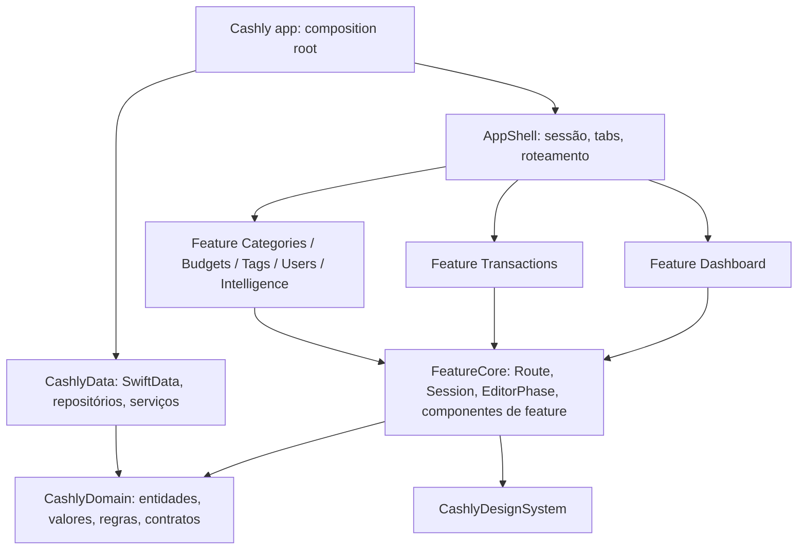

# Plano de refatoração: arquitetura enxuta SwiftUI-native

Proposta de 08/10/2026. Parte do working tree atual do branch `refactor/swiftui-ui-patterns`.

## Objetivo

Simplificar para escalar: adicionar uma feature nova deve ser seguir uma receita, sem precisar entender o resto do app.

- Cada feature isolada em seu próprio módulo, sem enxergar as outras.
- Poucos patterns, sempre os mesmos, cada um com um lugar fixo.
- Cada regra de negócio em um único lugar, testada.

Hoje o fluxo de uma ação atravessa `View → MainViewModel → CashlyDataFactoryProtocol.scoped(to:) → CashlyScopedRepository (7 protocolos) → CashlyRepository (actor de ~1.300 linhas)`, e as regras ficam espalhadas entre o repositório (agregação, conflitos), o `MainViewModel+Summary` (score, variação) e as telas (conflito no formulário de transação, dados de gráfico).

## O que não muda

A refatoração é estrutural. Estas decisões estão corretas e serão preservadas:

- `CashlySchemaV1`/`V2` congelados, `CashlyMigrationPlan` e a normalização em `prepare`. Nenhuma alteração no layout persistido.
- `Money` em centavos `Int64`, alocação determinística de centavos e parcelas.
- Um único `@ModelActor` dono do `ModelContext`, para salvar transação + participantes atomicamente.
- Escopo de usuário por janela, imutável; seleção de uma janela não afeta outra.
- Descarte de respostas antigas por revisão/cancelamento e o `ChangeHub` para invalidação.
- Navegação (`CashlyNavigation`, `MainRoute`, `open(_:in:)`): está boa e só será movida de lugar.

## Arquitetura alvo



Features não dependem umas das outras. Quando o Dashboard precisa abrir o editor de transação, ele chama `open(.transactionEditor(id:))`; quem sabe qual tela corresponde a cada rota é só o `AppShell`. O compilador garante o isolamento: um import entre features não compila.

| Camada | Responsabilidade | Não pode |
| --- | --- | --- |
| Domain | Entidades, value types (`Money`, `YearMonth`), regras puras (score, agregação, parcelas, conflitos) e protocolos de repositório | Importar SwiftUI/SwiftData; formatar texto de UI; ter extensions públicas em tipos da stdlib |
| Data | Persistir, consultar, mapear `@Model` ↔ entidade, sincronizar, treinar modelos locais | Calcular regra de negócio que não dependa do banco |
| FeatureCore | Contratos compartilhados entre features: `Route`, `open`, `Session` (usuário e repositórios da janela), `EditorPhase`, formatters | Conter tela ou model de uma feature específica |
| Feature* | Telas, `@Observable` models e drafts de uma feature | Importar outra feature; acessar `ModelContext` |
| AppShell | Tabs, pilhas de navegação, mapa rota → tela, sessão da janela | Ter regra de negócio ou estado de feature |
| App | Criar store, repositórios e sessão; injetar | Ter lógica |

### Patterns e onde ficam

Um conjunto pequeno e fixo. Qualquer código novo se encaixa em um destes; se não encaixa, é sinal para discutir antes de inventar outro.

| Pattern | Papel | Onde | Exemplo |
| --- | --- | --- | --- |
| Entity / Value Object | Dados e invariantes do negócio | `Domain/Entities`, `Domain/Values` | `Transaction`, `Money`, `YearMonth` |
| Domain Service (regra pura) | Cálculo sem I/O, testável sem banco | `Domain/Rules` | `BudgetHealth`, `OverviewAccumulator` |
| Repository | Acesso a dados por agregado, escopado ao usuário | protocolo em `Domain/Repositories`, implementação em `Data/Repositories` | `TransactionRepository` / `SwiftDataTransactionRepository` |
| Adapter (Mapper) | `@Model` ↔ entidade | `Data/Mapping` | `TransactionMapper` |
| Observable Model | Estado de tela + intenções | `Feature*/` | `TransactionEditorModel` |
| Draft | Campos editáveis + validação, sem SwiftUI | `Feature*/` | `TransactionDraft` |
| Router (Coordinator) | Navegação por rota, sem telas se conhecerem | `Route` em `FeatureCore`, mapa em `AppShell` | `open(.categoryDetail(id:))` |
| Composition Root + DI por init | Montar dependências uma vez | `App` e `Session` | `Session(scope:)` cria repositórios do usuário |
| Observer | Invalidação após escrita/sync | `Data/Services/ChangeHub` | models recarregam ao receber evento |

### Receita: adicionar uma feature

Revisada com o piloto `FeatureTags` (5.3). Exemplo: uma feature "Metas".

1. **Domain**: `Entities/Goal.swift`, `Repositories/GoalRepository.swift` (protocolo) e, se houver cálculo, `Rules/GoalProgress.swift` com teste.
2. **Data**: `@Model GoalEntity` em um novo schema versionado, mapeamento no `CashlyStore`, `SwiftDataGoalRepository` e o repositório no `Repositories`.
3. **Feature**: target `FeatureGoals`, que depende só de `CashlyDomain`, `CashlyDesignSystem` e `FeatureCore`:
   - `GoalDraft` (valores do formulário, `make…()` e `apply(_:)`), `GoalEditorModel` (`@Observable`, com `EditorStatus`, `canSave`, `canRemove`, `load`, `save`, `remove`);
   - `GoalEditorScreen` curta: `Form` com uma view por seção, `EditorActions` na toolbar e `.editorLifecycle(model.status) { await model.load() }`;
   - cada seção é uma `struct` própria que lê o model por `@Environment` e cria `@Bindable` no `body`;
   - `Resources/Localizable.xcstrings` com `sourceLanguage` pt-BR.
4. **Rotas**: `case` em `Route` e o mapeamento em `AppShell/RouteScreen` com `ModelHost(GoalEditorModel(…)) { GoalEditorScreen() }`; se for aba, um `case` em `AppSection`.
5. **Testes**: regra no Domain, repositório com store em memória e target `FeatureGoalsTests` com o model sobre `CashlyDatabase.open(inMemory: true)`.

Depois do build, `scripts/strings.sh` sincroniza os catálogos com as strings extraídas pelo compilador. Peças usadas por mais de uma feature (`UserMenu`, `IconSection`, `EditorActions`, `editorLifecycle`) ficam no `FeatureCore`.

### Estrutura de pastas

```
CashlyKit/Sources
├── CashlyDomain
│   ├── Values/          Money, YearMonth, TransactionAllocation
│   ├── Entities/        User, Category, Tag, Budget, Transaction, Participant (+ enums)
│   ├── Rules/           BudgetHealth, OverviewAccumulator, BudgetConflictDetector, Installments
│   ├── Repositories/    UserRepository, CategoryRepository, TagRepository,
│   │                    BudgetRepository, TransactionRepository, DashboardRepository
│   ├── Intelligence/    IntelligenceService (protocolo) e tipos
│   └── DomainError.swift
├── CashlyData
│   ├── Store/           CashlyStore (@ModelActor), Schema V1/V2/V3, Migration, Normalization
│   ├── Entities/        @Model
│   ├── Mapping/
│   ├── Repositories/    SwiftData*Repository (structs finas sobre o store, com userID fixo)
│   └── Services/        ChangeHub, LocalIntelligenceService, Metrics
├── FeatureCore          Route, AppSection, open, Session, EditorPhase, formatters, componentes de feature
├── FeatureDashboard     DashboardModel, HomeScreen e seções
├── FeatureTransactions  TransactionListModel, TransactionEditorModel, TransactionDraft, telas
├── FeatureCategories    (inclui detalhe de categoria)
├── FeatureBudgets       (inclui resolução de conflito)
├── FeatureTags
├── FeatureUsers
├── FeatureIntelligence
├── AppShell             RootView, MainScreen, tabs, mapa rota → tela
├── CashlyDesignSystem
├── CashlyResource
└── CashlyMock / CashlyPreview / CashlyAudit
```

`CashlyPresentation` e `CashlyUI` deixam de existir. Cada feature é um target com model, draft, telas e previews juntos. Encontrar "onde está o formulário de transação" passa a ser abrir `FeatureTransactions/`. Cada feature pode ter seu target de teste.

## Fases

Cada fase termina com: `scripts/build.sh Debug` passando, `scripts/lint.sh` passando, testes verdes, app aberto no simulador com os fluxos principais conferidos, e um commit próprio.

### Fase 0: checkpoint

Concluída: `f63f0b8`.


- Commit do working tree atual (137 arquivos) como está, para ter um ponto de retorno.
- Rodar build e lint e registrar o estado de partida.
- Corrigir ou remover `BudgetActorTests`/`CommonTestSuite`, que não acompanham a API atual.
- Remover os comentários restantes e adicionar a regra de lint que os proíbe.

### Fase 1: fundação do Domain

Concluída. `Score` foi para `FeatureCore` e terá suas regras extraídas na fase 2. Entidades deixaram de ser `Codable`; mocks passaram a ser `SampleData` em Swift.


- Criar `YearMonth` (struct com `year`/`month`, aritmética de meses, `Comparable`) e substituir os `Int` de competência (`Budget.date`, `TransactionQuery.month`, `billingStartMonth`, `occurs(in:)`).
- `Transaction.date` vira `Date`; a conversão de `TimeInterval` fica no mapeamento de Data.
- `TransactionQuery.statuses` vira `Set<TransactionStatus>`.
- Remover as extensions públicas em `BinaryInteger`, `Double`, `String`, `Data`, `Encodable`, `Sequence` de `CashlyDomain.swift`; formatação de moeda/percentual vai para `FeatureCore`.
- Tirar textos de UI do Domain (`TransactionStatus.summary`, `TransactionSplitMode.description`, `TransactionKind.title`, `shareMessage`): passam a ser extensions de apresentação em `FeatureCore`.
- Remover `User.empty`/`Participant.empty` e `selfFirstName`.
- Mover cada protocolo para seu arquivo (hoje `DashboardUseCase` está em `TransactionQuery.swift`, `SnapshotUseCase` em `CashlySnapshot.swift`).
- Testes: `Money`, `TransactionAllocation`, parcelas, `YearMonth`.

### Fase 2: regras de negócio no Domain

Concluída. Além do previsto, `BudgetUsage` concentra a razão gasto/orçamento e os estágios de uso, antes repetidos em seis pontos da UI.


- `BudgetHealth`: score, variação, restante, categorias em alerta (hoje em `MainViewModel+Summary`).
- `OverviewAccumulator`: struct que recebe lotes de transações/orçamentos e produz `Overview`. O repositório continua lendo em lotes de 500 e só alimenta o acumulador (hoje tudo dentro de `CashlyRepository+Queries.overview`).
- `BudgetConflictDetector`: detecção por usuário/categoria/mês (hoje duplicada entre `catalog` e `MainViewModel.budgetConflict`).
- Testes para as três regras.

### Fase 3: repositórios por agregado

Concluída. `CashlyDatabase` implementa `RepositoryProvider`; `CashlyStore` é o actor único; cada repositório é uma struct sobre `StoreScope`. Os antigos diagnósticos `flows` e `scenarios` do `CashlyAudit` viraram `CashlyDataTests` e `CashlyPresentationTests`.


- Trocar os 7 protocolos `*UseCase` (CRUD com 12 parâmetros) por repositórios que recebem entidades:

  ```swift
  public protocol TransactionRepository: Sendable {
      func transaction(id: Transaction.ID) async throws -> Transaction?
      func save(_ transaction: Transaction) async throws
      func delete(ids: Set<Transaction.ID>) async throws
  }
  ```

- O escopo de usuário fica só na construção do repositório. Saem os parâmetros `user:`/`userID:` redundantes e os `guard user == scope`.
- Remover APIs sem uso na interface (`getTransactions()` sem filtro, `removeUsers()`, `getBudgets(categories:date:)` etc.), mantendo o que `CashlyAudit` e treino usam.
- `CashlyRepository` vira `CashlyStore`: só transações de banco (fetch, require, commit, normalização). Cada `SwiftData*Repository` é uma struct com `store` + `userID`.
- Remover `CashlyScopedRepository` e `CashlyDataFactoryProtocol` (factory sai do Domain).
- Testes de integração com store em memória.

### Fase 4: composição e estado

Concluída. `CashlyWindow` monta `SessionModel`, `FinanceModel`, `TransactionListModel`, `IntelligenceModel` e `CashlyNavigation` e os injeta via `.cashlyWindow(_:)`. A rota cria o editor de cada formulário com `ModelHost`; as telas leem tudo por `@Environment`. O `DashboardState` deixou de trazer a primeira página da lista.


- `Session`: guarda o usuário da janela e os repositórios já delimitados a ele, criados uma vez por seleção. Substitui `CashlySession`, `CashlyPresentationFactory` e o `activeFactory` recalculado a cada chamada.
- Dividir `MainViewModel`:
  - `SessionModel`: lista de usuários, seleção, preferência persistida (encapsulando o `UserDefaults`).
  - `DashboardModel`: filtro → query, overview, conflitos.
  - `TransactionListModel`: paginação e remoção.
  - `CatalogModel`: categorias e tags do usuário, compartilhadas pelos formulários.
- Models recebem só os repositórios que usam, pelo `init`.
- Formulários: um `EditorPhase` (`idle/loading/saving/saved/failed`) e um helper de revisão em vez de repetir `isLoading/isSaved/hasLoaded/revision` em cinco ViewModels. Validação só no draft.
- Drafts sem SwiftUI: cor como hex no draft, `Color` só na view.

### Fase 5: features, design system e layout adaptativo

Dividida em dez etapas. Cada etapa termina com build nas três plataformas, lint, testes, conferência no simulador (iPhone em retrato, iPhone em paisagem e iPad) e um commit próprio no GitHub.

Decisões de 08/10/2026:

- **Visual atual mantido.** As telas continuam com a aparência de hoje: `List`/`Form` nativos, glass do sistema e cor de destaque do sistema, seguindo as diretrizes da Apple. Duas propostas de identidade nova foram testadas e rejeitadas em 08/10/2026.
- **Lista adaptativa.** Evolução do `AdaptiveList`/`AdaptiveSection` do bread-such: as seções que hoje esticam no iPad e em paisagem passam a se distribuir em colunas pela largura disponível, mantendo o estilo das seções atuais.
- **Inspector para formulários e detalhes.** `.inspector` nativo: painel à direita no iPad e no iPhone em paisagem, sheet no iPhone em retrato. Substitui o hack de UIKit do bread-such, que não roda em macOS e visionOS.
- **Uma reescrita por tela.** Os estilos reorganizados e os textos em pt-BR entram na fase 5: cada tela migrada já sai com a estrutura final, componentes nativos e strings no catálogo.

Regra de dependência: uma feature não importa outra. O que é usado por mais de uma feature (seletor de usuário, menu de filtro, estados vazios, gráficos, variação de categoria, modificador de inteligência, catálogo de símbolos) vai para `FeatureCore`.

#### 5.1 Base de targets

Concluída. A raiz do app (bootstrap do banco) continua no target do app, que é o composition root; o `AppShell` expõe `CashlyWindow` e `MainScreen`.


- `FeatureCore` passa a conter o estado compartilhado que hoje está em `CashlyPresentation`: `SessionModel`, `FinanceModel`, `IntelligenceModel`, `EditorStatus`, `TransactionFilter`, `UserPreference`, `ModelHost`, Environment values, rotas (`MainRoute` vira `Route`, `CashlySection` vira `AppSection`) e `CashlyNavigation`.
- Novo target `AppShell`: `CashlyWindow`, `MainScreen`, mapa rota → tela e a raiz do app. Durante a migração depende de `CashlyUI` e de cada feature já migrada.
- `CashlyPresentation` fica só com os editores e o `TransactionListModel`, que saem nas etapas seguintes.
- Pronto quando o app se comporta exatamente como antes.

#### 5.2 Estilos e layout adaptativo

Concluída, sem mudança visual no iPhone em retrato.

- `CashlyDesignSystem` organizado em `Styles/` (extensions de `ShapeStyle`: `.positive`, `.negative`, `.warning`, `.info`, `.disabled`, `.subtleFill`, `.rowFill`, `.groupedBackground`, `.groupedRow`; `ToolbarItemPlacement.leading`; `Color(hex:)`), `Modifiers/` (extensions de `View`: `surface`, `contentSurface`, `prominentButton`, `dismissKeyboardOnScroll`, `loading`, `deleteAction`, `editAction`), `Layout/` (`AdaptiveList`, `SurfaceContainer`, `FixedToolbarSpacer`) e `Legacy/` (os wrappers antigos, que agora só encaminham para os novos e saem na 5.10). `errorAlert` foi para `FeatureCore`.
- `AdaptiveList`: recebe as mesmas `Section` de uma `List`. Com largura para uma coluna, é a `List` nativa; com mais, lê as seções com `Group(sections:)` e as distribui em colunas de no mínimo 320 pt, com a aparência agrupada do sistema. A Home já usa.
- Navegação adaptativa: em largura regular as rotas abrem no `.inspector` da janela (sheet no visionOS); em compacta, por push. `\.close` fecha a rota no contexto certo (inspector, pilha do inspector ou pilha da aba). O inspector fica na `TabView` porque, preso a cada pilha, empurra a barra da tela para baixo da barra de abas.
- Correção: gráficos com rolagem horizontal travavam o app no iPad quando havia menos pontos que o domínio visível; a rolagem agora só liga quando há pontos sobrando.

#### 5.3 Piloto: `FeatureTags`

Concluída.

- `FeatureTags`: `TagDraft`, `TagEditorModel` (agora com `symbolCategory`, `canRemove` e `color`), `TagEditorScreen`, `TagIconHeader`, `TagNameSection` e o String Catalog.
- `FeatureCore` ganhou `SymbolCategory` (antes `CashlySymbolCategory`, nomes em pt-BR), `IconSection` (faixa para tag, grade para categoria; o editor de categoria já usa), `IconChoice`, `UserMenu` (antes `UserItemView`, adiantado da 5.4 porque o editor de tag o usa), `EditorActions` e `.editorLifecycle`. A escolha de usuário passou para `SessionModel.userSelection`.
- `.sectionTitle()` no design system; `scripts/strings.sh` para os catálogos.
- `CashlyMock` deixou de depender do `AppShell` (o modificador de preview foi para `CashlyPreview`), e o `CashlyAudit` voltou a rodar no Mac.
- Os testes rodam no simulador (`scripts/test.sh`): o `FeatureCore` usa APIs do SwiftUI 27 que o macOS 26 do host não tem.

#### 5.4 `FeatureUsers`

Concluída.

- `FeatureUsers`: `UserDraft`, `UserEditorModel` (com `avatarStyle`, `shufflePhoto()`, `canRemove` e `userToSelect`), `AvatarStyle` (as faixas de fotos saíram do draft), `UserEditorScreen` e as seções `UserPhotoHeader`, `UserNameSection` e `AvatarSection`.
- `.editorLifecycle(_:selecting:)` seleciona o usuário recém-criado depois de salvar, no lugar de recarregar a sessão.
- `FeatureCore` ganhou `EmptyStateCard` (antes `CashlyCardView`, usado pelos estados vazios) e `EmptyUsersSection` (antes `EmptyUserView`), que Home, Categorias e Transações já usam.

#### 5.5 `FeatureCategories`

Concluída.

- `FeatureCategories` em três pastas: `List/` (`CategoryListScreen` em `AdaptiveList`, `CategoryBalanceSection`, `BudgetedCategoriesSection`, `CategoryRow`, `UnbudgetedCategoriesSection`), `Detail/` (`CategoryDetailScreen`, `CategoryDetailHeader`, `CategoryBudgetsSection` e uma extensão do `FinanceModel` com a categoria de reserva e o uso de cada orçamento) e `Editor/` (draft, model com `symbolCategory`, tela e seções). `CategoryBadge` é o ícone circular usado nas três.
- `FeatureCore` ganhou `FilterMenu` (antes `FilterItemView`), `MultiSelectMenu`, `CategoryVariation`, `EmptyCategoriesSection`, `EmptyBudgetsSection` e `DataStatusSection`. Mês, ano, período, "personalizado" e limpar o filtro viraram regras do `TransactionFilter`; a cor dos pontos de variação virou `BudgetUsage.Stage.dotColor(at:)`.
- Abas em pt-BR.
- Correção: na lista de categorias do iPhone, os valores quebravam em duas linhas e eram cortados ("500.000,…"); agora o valor ocupa a largura dele.
- Cuidado aprendido: em cabeçalho de `List`, `.foregroundStyle(.primary)` é relativo ao cinza do cabeçalho; use `Color.primary`, como o código antigo.

#### 5.6 `FeatureBudgets`

Concluída.

- `FeatureBudgets/Editor`: draft, `BudgetEditorModel` (com `canRemove` e a sugestão de valor da inteligência, que antes passava por estado e `onChange` na view), `BudgetEditorScreen` e as seções de valor, descrição, categoria e data.
- `FeatureBudgets/Conflict`: `BudgetConflictModel` com o estado e as ações que estavam na view, e `BudgetConflictScreen`.
- `FeatureCore` ganhou `CurrencyField`, `CurrencyInput` e `CategorySelector`; `.editorLifecycle` aceita `reloadingOn:`.
- Correção adiantada da 5.7: o campo de valor trata os dígitos como centavos. Vale para orçamento agora e para transação quando ela migrar.

#### 5.7 `FeatureTransactions`

Concluída.

- `FeatureTransactions/List`: `TransactionListModel` (agora com seleção, grupos por dia, valores do período, mensagem de compartilhamento e exclusão da seleção), `TransactionListScreen`, `TransactionListToolbar`, `TransactionDaySection`, `TransactionRow`, `TransactionBalanceSection` e `LoadMoreRow`. A lista continua `List` (swipe e seleção), com largura de leitura no iPad.
- `FeatureTransactions/Editor`: o editor de 499 linhas virou uma tela curta e oito seções (valor, descrição, conflito, tags, categoria, data, parcelamento e participantes). Previsão de categoria, tags, participantes, parcelas, status da divisão e mensagem de orçamento foram para o `TransactionEditorModel`; o modificador de previsão deixou de existir.
- Correção: o editor guarda a transação original e calcula o impacto da edição no período filtrado, então a mensagem de orçamento restante e a barra de variação não contam mais a transação duas vezes.
- `FeatureCore` ganhou `PeriodSummaryHeader` (também usado em Categorias), `SessionModel.otherUsers` e status e modos de divisão em pt-BR; `readableWidth()` voltou ao design system.
- `CashlyPresentation` ficou vazio e saiu; `CashlyPresentationTests` virou `FeatureCoreTests`.
- `scripts/test.sh` passou a usar `-collect-test-diagnostics never`: com teste falhando, o `xcodebuild` coletava um sysdiagnose do simulador e ficava mais de 10 minutos parado.

#### 5.8 `FeatureDashboard`

- Home em `AdaptiveList`: saldo e score, disponível, comparação planejado × gasto, maiores gastos, tags, previsão.
- Pontos de gráfico e seleções padrão saem da view e vão para o model.
- Gráficos vão para `FeatureCore`.

#### 5.9 `FeatureIntelligence`

- Tela de inteligência e monitor do sistema; o modificador de previsão usado pelos editores vai para `FeatureCore`.

#### 5.10 Encerramento

- Remover `CashlyUI` e os wrappers triviais do DesignSystem (`CashlyPresentation` já saiu na 5.7).
- Previews por feature com `SampleDatabase`.
- Passada final em iPhone retrato/paisagem, iPad e macOS.

### Fase 6: acabamento

- `CashlyAudit` como suíte automatizada de integração e diagnóstico, rodando por script e no CI.
- Regras de lint para `file_length`, `type_body_length` e `function_parameter_count`, para o código não voltar ao estado anterior.
- Consolidar os documentos de `docs/` em `architecture.md` + registro de decisões; remover revisões que já viraram código.

### Fase 7: Settings

Pedida em 08/10/2026. Primeira feature nova construída pela receita, como target `FeatureSettings`, com uma seção por tópico:

- **Aparência**: tema (sistema, claro, escuro) e ícone do app (ícones alternativos).
- **Moeda**: hoje `Money.currencyCode` é fixo em BRL. Escolher outra moeda exige guardar a moeda por registro no domínio e no schema; até lá, a opção mostra BRL.
- **Notificações**: permissão e lembretes (por exemplo, orçamento perto do limite). Depende de definir quais alertas o produto terá.
- **Armazenamento e dados**: exportar, importar e apagar tudo, com confirmação.
- **iCloud**: ligar e desligar a sincronização (`CashlyDatabase.open(cloudSync:)`), estado da última sincronização e backup.
- **Ajuda**: avaliar o app, novidades da versão, fale conosco, central de ajuda.
- **Sobre**: privacidade, termos de serviço, compartilhar com um amigo.
- **Integrações (futuro)**: Calendário, servidor MCP para Claude Code, Atalhos, importador, App Intents/Siri, Foundation Models. Entram como seção "em breve" até cada uma ser implementada.

A ordem de implementação parte do que não exige mudança de domínio (aparência, ajuda, sobre, dados, iCloud) e deixa moeda, notificações e integrações para etapas próprias.

## Decisões

Aprovadas em 08/10/2026.

1. Um target SPM por feature.
2. Wrappers triviais do DesignSystem removidos ao fim da fase 5 (5.10).
3. UI só em pt-BR, via String Catalog.
4. `CashlyAudit` concentra as ferramentas de teste e diagnóstico: fixtures, integração com store real em memória e validação automatizada (migração, integridade, desempenho), executadas por script e no CI.

## Regras de código

- Sem comentários em código Swift, inclusive cabeçalhos e doc comments. Exceção: `// swift-tools-version` do manifesto. O lint bloqueia.
- O mais simples que resolva: sem abstração antecipada, sem protocolo para tipo com uma única implementação fora de fronteira de módulo.
- Sem extensions públicas em tipos da stdlib.
- Uma responsabilidade por tipo e um tipo principal por arquivo, com o nome do arquivo.

### Views

- Todo model chega pela view via `@Environment(Tipo.self)`. Para editar, `@Bindable var model = model` dentro do `body`. Views não recebem model por `init` nem guardam model em `@State`.
- Dados e ações ficam sempre no model. A view só lê estado e chama métodos: sem cálculo, regra ou formatação de negócio.
- Cada tela é separada da sua construção: quem cria o model e injeta no Environment é a rota/`AppShell`, não a tela.
- Componentes, seções e ações isolados em views pequenas; uma tela é a composição delas, com pouco código.

## Fora de escopo

Mudanças de produto (exceto a tela de Settings da fase 7), de schema persistido e de algoritmo de inteligência. Desempenho do dashboard em 100 mil registros (projeções incrementais) continua como item separado em `execution-plan.md`.
