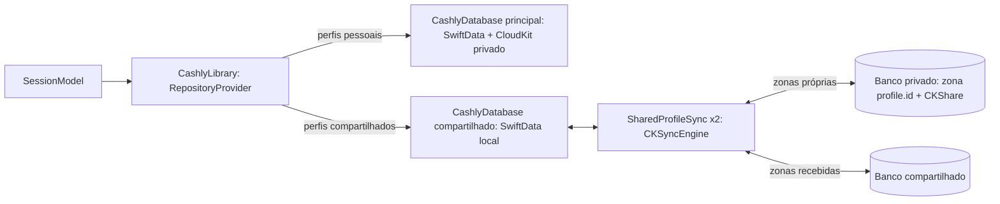

# Social: perfil compartilhado (18/10/2026)

O Cashly deixa de ser só individual: um **perfil compartilhado** reúne o dinheiro da casa, do casal ou da família, e cada pessoa usa o próprio aparelho. Os perfis pessoais continuam privados. Escolhido pelo Rafael em 18/10/2026 entre três desenhos (perfil compartilhado, amigos e desafios, dividir despesas); os outros dois ficam para depois, sobre a mesma base.

## Decisões

- **Desenho A, perfil compartilhado.** É o uso social de maior valor num app de finanças e cabe no conceito de perfil que o app já tem: todas as telas funcionam igual num perfil compartilhado.
- **Tudo grátis.** Criar, convidar e participar não dependem do Cashly Pro. Os recursos Pro continuam Pro em qualquer perfil.
- **Sem servidor próprio.** Tudo passa pelo compartilhamento do CloudKit; a VPS não participa e a carga é da Apple.
- **Rótulo "Dados não coletados" mantido.** Os dados ficam no iCloud de quem cria e aparecem para quem foi convidado; o desenvolvedor não tem acesso a nada. O banco público continua só para as flags.
- **Lançamento por flag:** `social` no CloudKit público (admin › Flags), **desligada por padrão**. Desligada, o app esconde as entradas, não liga a sincronização compartilhada e os perfis compartilhados já existentes ficam como estão no aparelho.

## Como a pessoa usa

1. **Criar:** menu do avatar › "New Shared Profile". O editor de perfil abre com uma seção que explica o compartilhamento e, se o perfil atual tiver categorias, "Copy Categories from <perfil>". Salvar cria o perfil e abre a folha de convite.
2. **Convidar:** folha no padrão de guia ("Invite Who Shares It") com o botão "Invite People", que abre a folha de compartilhamento do sistema (Mensagens, Mail, AirDrop, copiar link). Só quem criou convida. O convite vale só para as pessoas escolhidas, com permissão de leitura e escrita.
3. **Entrar:** quem recebe toca o link; o Cashly abre, aceita o convite e mostra a folha "You Joined <perfil>" com "Open Profile". O perfil aparece no menu do avatar, ao lado dos perfis pessoais.
4. **Usar:** transações, categorias, orçamentos, tags, Início, relatórios e Jornada funcionam como num perfil pessoal; o que um registra aparece para os outros.
5. **Gerenciar:** editor do perfil › "People" abre a tela do perfil compartilhado: quem está (dono, convite pendente, entrou), "Invite People", estado da sincronização e as saídas.
6. **Sair ou encerrar:**
   - quem foi convidado: "Leave Profile" (o perfil some deste aparelho; os dados continuam para os outros);
   - quem criou: "Remove" numa pessoa, "Stop Sharing" (todos saem, o perfil continua com o dono) ou "Delete for Everyone" (apaga o perfil e os dados de todos).
   - Toda saída é confirmada numa folha de guia.

## Regras

- **Divisão (participantes):** num perfil compartilhado, o seletor de participantes fica escondido; num perfil pessoal, ele só oferece perfis pessoais. Os participantes dependem de perfis do mesmo banco, e "quem lançou" fica para a fase 2.
- **Excluir pelo editor:** o botão de excluir some nos perfis compartilhados; a saída é sempre pela tela do perfil compartilhado.
- **Backup e "apagar tudo"** continuam valendo só para os perfis pessoais. O perfil compartilhado mora no iCloud de quem criou.
- **Sem conta iCloud** (ou no simulador), a criação e o convite explicam o motivo e mostram "Open Settings".
- **Ao sair da conta iCloud ou trocar de conta,** o app apaga deste aparelho os perfis compartilhados (os dados continuam no iCloud).
- **Conflitos:** o último a editar vence, por registro, pela data da edição local (`editedAt`). Uma exclusão vinda de outra pessoa vence, a não ser que este aparelho tenha uma edição ainda não enviada daquele registro (aí ele volta). Registro que este aparelho nunca confirmou (estado perdido ou reinstalação) adota o do servidor. Orçamentos repetidos na mesma categoria e mês continuam caindo na resolução de conflito que já existe.
- **Jornada:** os eventos da Jornada (`GameEvent`) não sincronizam nesta fase; o XP vem das transações, que sincronizam, e créditos da loja, guias e desafios ficam em cada aparelho. A Jornada do perfil compartilhado é a fase 2.

## Arquitetura

O SwiftData (inclusive o 27) só espelha o banco **privado** do CloudKit; ele não lê nem grava zonas compartilhadas. Por isso:

- **Dois bancos.** O principal continua igual. Os perfis compartilhados moram num segundo `CashlyDatabase` (`Sharing.store`, mesmo schema, sem CloudKit), sincronizado por `CKSyncEngine`.
- **`CashlyLibrary`** (CashlyData) é o `RepositoryProvider` do app: devolve os repositórios do banco certo pelo perfil, junta os perfis dos dois bancos no diretório (`User.isShared` marca os compartilhados) e junta os avisos de mudança. Janelas, App Intents, widgets, MCP e Web recebem a biblioteca no lugar do banco.
- **Uma zona por perfil** (`profile.<id>`) no banco privado de quem criou, com um `CKShare` da zona inteira (`publicPermission = .none`, título = nome do perfil). Quem aceita enxerga a zona no banco compartilhado.
- **Dois motores:** um `CKSyncEngine` no banco privado (zonas próprias, excluindo a zona do Core Data) e outro no banco compartilhado (zonas recebidas), cada um com o estado em `Application Support/Sharing/<escopo>.json`.
- **Um registro por linha:** tipos `Profile`, `Category`, `Tag`, `Budget`, `Transaction` e `Participant`, nome `<tipo>.<id>`. O conteúdo vai num único campo cifrado (`encryptedValues["payload"]`, JSON canônico da linha) mais `editedAt` (data da edição local, para o último a editar vencer). Capturas e memória de estabelecimentos não sobem.
- **Detecção de mudanças por diferença:** depois de cada gravação no banco compartilhado (com 1 s de espera), o motor compara o resumo SHA-256 de cada linha com o último que o servidor confirmou e marca o que salvar e apagar. Robusto contra mudanças em cascata e auto-corrigível; o que chega do servidor já entra com o resumo certo e não volta.
- **Decisões num tipo puro:** `SharedSyncPolicy` decide o que chega (aplicar ou manter a edição local), exclusões remotas, conflito (`serverRecordChanged`), registro sumido do servidor (`unknownItem`) e a data enviada (nunca inventa "agora" para o que não foi editado aqui). Testado sem CloudKit.
- **Sem eco:** o que chega entra no banco com uma mudança marcada como remota, que não dispara a comparação; o resumo confirmado é o da linha recodificada no aparelho, então versões com campos diferentes não reenviam o que receberam. A comparação espera a primeira busca quando o estado é novo.
- **Falha ao aplicar:** o registro fica guardado no estado (`parked`) e é aplicado de novo na próxima comparação; o estado é gravado logo depois de cada busca e envio.
- **Aceite do convite:** `CKSharingSupported` no `Info.plist`; no iOS e no visionOS um `UIWindowSceneDelegate` recebe `userDidAcceptCloudKitShareWith`; no Mac, o `NSApplicationDelegate`.
- **Interface:** `ProfileSharing` (protocolo no FeatureCore, implementado pelo `SharingCoordinator` do CashlyData) e `SharingModel` (FeatureCore, um por processo). As telas ficam no target `FeatureSharing`.

## Infraestrutura

- **CloudKit:** os tipos de registro nascem em Desenvolvimento na primeira gravação; antes de lançar, o Rafael faz o **Deploy Schema Changes** para Produção (irreversível, fica com ele). Nada de índice: o app não consulta esses tipos.
- **Push:** os motores usam a assinatura do próprio `CKSyncEngine` e o push silencioso que o app já recebe (`remote-notification`).
- **Admin:** a flag `social` entra na lista do painel (`admin/src/flags.mjs`), padrão desligada.
- **Cota:** os dados contam no iCloud de quem criou o perfil.

## Fases

1. **Fundação e perfil compartilhado (esta entrega):** biblioteca e segundo banco, motores, convite, aceite, pessoas, sair, remover, parar de compartilhar, apagar para todos, estado da sincronização, flag, folhas de guia, 10 idiomas, testes.
2. **Juntos no dia a dia:** "quem lançou" em cada transação, Jornada do perfil compartilhado (desafios do casal), aviso de novidades de outra pessoa.
3. **Transformar um perfil pessoal em compartilhado** (copiar os dados para a zona e apagar do banco principal).
4. **Depois:** cobrança com Pix a partir de uma despesa dividida (desenho C1) e, se fizer sentido, cartão de progresso para amigos (desenho B).

## Verificação

- Testes: código dos registros (ida e volta de cada tipo), plano de diferenças, biblioteca (roteamento, diretório, avisos), aplicação e remoção de registros no banco compartilhado, `SharingModel` com um serviço falso.
- No iPhone físico, um lado: criar o perfil, abrir o convite e ver a zona e o compartilhamento no CloudKit Console (Desenvolvimento). O aceite por uma segunda conta iCloud fica com o Rafael (decisão de 18/10/2026).

## MCP para o Claude Code (implementado)

**Onde roda:** dentro do próprio app, em qualquer aparelho (Mac, iPhone, iPad, Vision Pro), ligado em Ajustes › Claude Code. Por padrão atende só o próprio aparelho (127.0.0.1); com "Aceitar conexões da rede local", computadores da mesma rede alcançam o aparelho pelo IP mostrado no comando de instalação (e por Bonjour, `_cashly-mcp._tcp`). No iPhone e no iPad, o app precisa estar aberto.

**Segurança em três camadas:**
1. **Token** no cabeçalho `Authorization`, gerado pelo app e trocável a qualquer momento (trocar desconecta todos).
2. **Aprovação da conexão no app:** quando um cliente novo chama `initialize`, o app mostra "Conectar o Claude Code?" com o nome do cliente e o endereço. Sem aprovação não há sessão (`Mcp-Session-Id`), e qualquer outra chamada é recusada. Conexões aprovadas ficam listadas nos Ajustes e podem ser removidas.
3. **Aprovação de toda escrita:** `import_transactions` abre a conferência no padrão dos guias (totais, categorias e tags novas, problemas) com Importar ou Recusar. O Claude recebe importado, recusado ou aguardando.

**Ferramentas:** `get_catalog`, `get_summary`, `list_transactions`, `list_budgets`, `run_analysis`, `import_transactions`.

**Plugin:** `plugins/cashly`, com as skills `cashly-import` e `cashly-insights` (ver README).

**Login com Apple:** não adotado por enquanto. Sem servidor próprio, o token de identidade da Apple não teria quem o validasse; a aprovação no aparelho é que garante quem conecta. Quando a parte social chegar, a identidade vem do iCloud da pessoa (`CKContainer.userRecordID`), sem tela de login.

